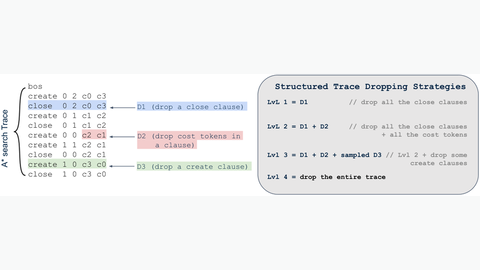

# Dualformer

Dualformer trains a transformer on randomly dropped reasoning traces.

*Paper figure (diagram) showing an A* search trace and the four levels of structured trace dropping (drop close clauses, cost tokens, some create clauses, or the whole trace) used to train Dualformer. Source: [Su et al., Dualformer, Figure 3.1](https://arxiv.org/abs/2410.09918).*

| | |
|---|---|
| Year | Oct 2024 |
| Links | [Dualformer](https://arxiv.org/abs/2410.09918) |
| Demo | None found (searched: arXiv abstract page, code repo [facebookresearch/dualformer](https://github.com/facebookresearch/dualformer) README and homepage field, ICLR 2025 virtual poster page, web search for demo, video and Hugging Face Space) |
| Category | post-training |
| Method | train on randomly dropped reasoning traces; distil |
| Evaluated on | mazes, QA |
| Evaluation play mode | static |
| Basis | papers: Dualformer §4.1 maze/Sokoban as one-shot generation |
| What is trained | transformer / LLM |

## Demo

- None found. The arXiv page has no comments field and links only the code repo; the repo has no homepage set and its README has no images or videos (it points to Jupyter notebooks and a MongoDB dataset setup); the ICLR 2025 poster page has no recorded video; web searches turned up no project page, Hugging Face Space or video.

Searched 10 November 2026; no demo found.

## What the team could reuse

- Data recipes: trace dropout (Dualformer) (from the post-training reuse list).

Related: [Distilling System 2 into 1](distilling-system-2-into-1.md)
