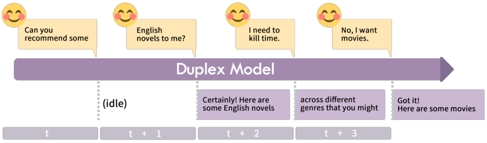

# Duplex models / MiniCPM-Duplex

Duplex models (MiniCPM-Duplex) read a time slice of text, write a slice or stay idle.

*Paper figure (diagram) of a duplex model processing the user's input in time slices: it stays idle at t+1, starts answering at t+2, and switches to movies once the user interrupts during t+3. Source: [Zhang et al., arXiv 2406.15718](https://arxiv.org/abs/2406.15718).*

| | |
|---|---|
| Year | 2024 |
| Links | [arXiv 2406.15718](https://arxiv.org/abs/2406.15718) |
| Demo | None found (searched: arXiv abstract page, thunlp/duplex-model GitHub README and repo files (no homepage set), Hugging Face model card and Spaces, web search for "MiniCPM-duplex demo" and demo video). The repo ships only a self-hosted Next.js chat demo that needs a local model server on ws://localhost:8765. |
| Category | realtime architecture |
| Method | Reads a slice, writes a slice or stays idle |
| Evaluation play mode | static (benchmarks) + realtime-live (speech) user study |
| Open source | Fine-tuned from MiniCPM |
| Basis | paper §4.4 "the user's speech is processed every 2 seconds"; §4.5 user study |
| Channels (in / out) | text / text |
| Tick | time slices |

## Details

- **Streaming and duplex text models.** Duplex models (time slices of text), StreamingThinker (think while reading, with separate position IDs and parallel KV caches), Asynchronous Reasoning (training-free concurrent thinking and writing). These are the nearest text-only mechanisms for new input landing mid-thought. All are evaluated on static QA or chat.

## Demo

- None found. The [thunlp/duplex-model](https://github.com/thunlp/duplex-model) README has a "Try MiniCPM-duplex" section, but it is build-it-yourself instructions (run `model_server_duplex.py`, then `yarn dev` on localhost:3000) with no hosted page, video or GIF; its only media are two static figures (traditional LLM vs. duplex model). The Hugging Face model card [xinrongzhang2022/MiniCPM-duplex](https://huggingface.co/xinrongzhang2022/MiniCPM-duplex) lists no Spaces, and no Space search hit belongs to this work. Later OpenBMB MiniCPM-o full-duplex demos are separate work.

Searched 10 November 2026; no demo found.

## What the team could reuse

- Serialisation ideas for post-training a text model: time slices (from the architectures reuse list).

Related: [StreamingThinker](streamingthinker.md); [Asynchronous Reasoning](asynchronous-reasoning.md)
