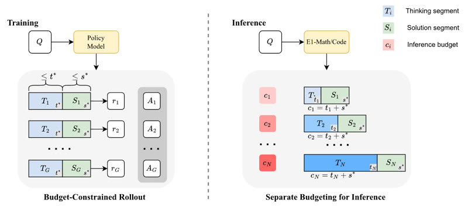

# Elastic Reasoning

Elastic Reasoning trains a reasoning LLM with GRPO on budget-constrained rollouts.

*Framework diagram (paper Figure 2): left, GRPO training with rollouts capped at t\* thinking and s\* solution tokens; right, inference that splits each total budget c into a thinking part t and a solution part s\*. Source: [Xu et al., arXiv 2505.05315](https://arxiv.org/abs/2505.05315).*

| | |
|---|---|
| Year | 2025 |
| Links | [arXiv 2505.05315](https://arxiv.org/abs/2505.05315) |
| Demo | [Hugging Face Space "Efficient-Reasoning"](https://huggingface.co/spaces/Salesforce/Efficient-Reasoning) (linked as "Blog" from the repo README): a static Gradio explainer page with the paper's framework diagram and AIME / LiveCodeBench result figures. No live model, no game, not interactive. |
| Category | post-training |
| Method | GRPO with budget-constrained rollouts |
| Evaluated on | math, code |
| Evaluation play mode | static |
| Basis | paper §4: math and code benchmarks |
| What is trained | reasoning LLM |

## Demo

- [project-page] [Hugging Face Space Salesforce/Efficient-Reasoning](https://huggingface.co/spaces/Salesforce/Efficient-Reasoning) (linked as "Blog" from the [repo README](https://github.com/SalesforceAIResearch/Elastic-Reasoning)) — I rendered the Space and its Gradio iframe (salesforce-efficient-reasoning.hf.space) and dumped its text, images and inputs. It is a static explainer: "This demo is structured in two parts", with "Part 1: Elastic Reasoning" (introduction, "Main Takeaways", the training/inference framework figure, aime.png, livecode.png, codetable.png) and "Part 2: Fractured Chain-of-Thought" (a sibling paper, with frac_cot.gif and scaling plots). There are no text inputs, no buttons that run a model, no video and no game. Play-mode evidence: none; the page shows only offline math and code benchmark figures, which matches the file's "static" label.

Visited 10 November 2026 in a headless browser.
