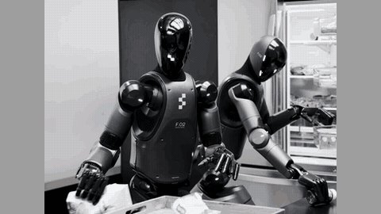

# Figure Helix

Figure Helix is a robotics dual system with a 7-9 Hz VLM and a 200 Hz policy linked by a latent.

*A 4-second excerpt from the hero video on Figure's Helix announcement page: an edited recording of two Figure 02 robots, both running the same Helix weights, putting away groceries at a fridge (cropped, no on-screen clock). Source: [Figure, "Helix: A Vision-Language-Action Model for Generalist Humanoid Control"](https://www.figure.ai/news/helix).*

| | |
|---|---|
| Year | Feb 2025 |
| Category | scaffold (robotics dual system) |
| Results | real-robot demonstrations, no quantitative evaluation |
| Demo | [Figure announcement page](https://www.figure.ai/news/helix): official page with a 2 min 54 s main video and six captioned clips of Figure 02 robots running Helix (two-robot grocery storage, fridge put-away, language-commanded picking). Edited recordings of real-robot runs; nothing live, no viewer, not playable. |

## Details

- Robotics dual systems (brief). Figure Helix: 7-9 Hz VLM, 200 Hz policy, linked by a latent (Figure's announcement page, saved; real-robot demonstrations, no quantitative evaluation).

## Demo

- [official-video] [Helix: A Vision-Language-Action Model for Generalist Humanoid Control](https://www.figure.ai/news/helix) (Figure, 20 February 2025) — Opened the page, played the videos muted and seeked the main video (VLA_Full_Quality_MASTER_21925A.mp4, 173.97 s) to 20 s, 90 s and 151 s. It shows a hero clip and captioned clips: "Video 1: Collaborative grocery storage. A single set of Helix neural network weights runs simultaneously on two robots as they work together to put away groceries neither robot has ever seen before."; "Video 2: Helix allows for fast fine grained motor adjustments, necessary when reacting to a collaborative partner, while carrying out novel semantic goals."; "Video 5: Helix translates high level conceptual commands like "Pick up the desert item" to low-level action."; "Video 6: "Pick up the helix"". The frames show two Figure 02 robots at a kitchen counter and an open fridge passing items to each other. The page text describes S2 at "7-9 Hz" and S1 at "200 Hz". Play-mode evidence: static MP4 recordings served from videos.ctfassets.net with no on-screen clock or step readouts. They show the real robots acting in real time, but the clips are edited recordings, not a live or interactive demo. The page has no game element.

Visited 10 November 2026 in a headless browser.

Related: [Hi Robot](hi-robot.md); [FiS-VLA](fis-vla.md); [Think at 5 Hz, Act at 20 Hz](think-at-5hz-act-at-20hz.md)
