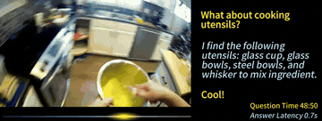

# Flash-VStream

Flash-VStream is a streaming video LLM.

*A 5 s clip of the authors' recorded demo video: the question "What is happening now?" is asked at stream time 53:00 and the model's answer appears beside the cooking video, labelled "Answer Latency 1.0s". Source: [Flash-VStream project page](https://invinciblewyq.github.io/vstream-page).*

| | |
|---|---|
| Category | realtime architecture (streaming video LLM) |
| Demo | [2024 project page](https://invinciblewyq.github.io/vstream-page) with a 2:01 recorded demo video (demo_0706_reencode.mp4): the model answers questions at set times during an egocentric cooking video, with "Question Time" and "Answer Latency" overlays (for example 1.2 s). It is a recording, not a game and not live; the linked Hugging Face Space (IVGSZ/Flash-VStream-demo) returns 404. The [ICCV 2025 project page](https://zhang9302002.github.io/vstream-iccv-page/) has only static figures. |

## Details

- **Streaming video LLMs** (VideoLLM-online, Flash-VStream, Dispider, StreamBridge, LiveCC, StreamingVLM, OmniMMI/M4, Proact-VL). The only "action" is when to speak. Evaluations replay recorded video and mostly score offline.

## Demo

- [video] [Flash-VStream 2024 project page](https://invinciblewyq.github.io/vstream-page) — Opened the page, played the embedded 121 s video (static/images/demo_0706_reencode.mp4), and grabbed frames at 0:05, 0:20, 0:30, 0:40, 1:00, 1:30 and 1:55. The video opens with the title card "Flash-VStream can perform online video QA at realtime (with ~1s latency)." It then plays an egocentric cooking video, with user questions and model answers shown in a side panel at set stream times. Examples are "How is the person controlling the cooking temperature to cook shawarma?" ("Question Time 14:20") and "Recall what happens since the person grabbed flour from the flour bags." ("Question Time 56:00", "Answer Latency 1.2s"), which ends with "Nice! That's all for the test, you have done a great job!". Play-mode evidence (recording): an edited, pre-recorded video QA session that shows per-answer latency against stream time; there is no game and no live model call.
- [none] [Hugging Face Space IVGSZ/Flash-VStream-demo](https://huggingface.co/spaces/IVGSZ/Flash-VStream-demo) — The 2024 project page links it as "Demo", but it returned a 404 page in the browser, and the API returned 401 for the Space. Play-mode evidence: none.
- [project page] [Flash-VStream ICCV 2025 project page](https://zhang9302002.github.io/vstream-iccv-page/) — This is the repository's homepage field. Opened it and listed its media: only static images (teaser, efficiency plot, framework, benchmark tables, PCA/case-study figure), with no video or interactive element. Play-mode evidence: none.

Visited 10 November 2026 in a headless browser.

Related: [VideoLLM-online](videollm-online.md); [Dispider](dispider.md)
