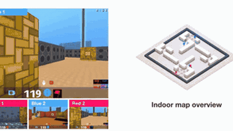

# FTW

FTW is a Quake III CTF agent that reacts in 258 ms against 559 ms for humans, with a post-hoc added-delay study.

*Recording of four trained FTW agents playing indoor Capture the Flag: Blue 1's raw-pixel observation (large), its teammate's and opponents' views (bottom) and a top-down map overview; real-time 5 s excerpt. Source: [DeepMind, "Capture the Flag: from pixels to actions"](https://www.youtube.com/watch?v=OjVxXyp7Bxw).*

| | |
|---|---|
| Year | 2018-19 |
| Links | [arXiv 1807.01281](https://arxiv.org/abs/1807.01281) |
| Demo | [DeepMind blog](https://deepmind.google/blog/capture-the-flag-the-emergence-of-complex-cooperative-agents/) with an embedded [CTF replay viewer](https://storage.googleapis.com/deepmind-media/research/ctf/index.html) (6 recorded 4,500-frame matches, agent-only and human+agent, top-down 3D with timeline and score) and official YouTube videos of agents playing. All recordings; not live and not human-playable. |
| Category | RL and decision model |
| Method | reacts in 258 ms against 559 ms for humans; no win-rate loss up to 375 ms added delay |
| Evaluated on | Quake III CTF |
| Evaluation play mode | realtime-live vs humans |
| Basis | paper: "respond to newly appeared opponents in 258ms, compared with 559ms for humans"; "up to 375ms did not effect the win probability" |

## Details

- **FTW.** A post-hoc delay study: added response time up to 375 ms did not change win probability; at 448 ms the win rate fell to 85%. This is the template for a reaction-time-versus-score curve.
- Human reference numbers used as constraints: FTW humans 559 ms to respond to a new opponent (agents 258 ms).

## Demo

- [replay viewer] [CTF game explorer](https://storage.googleapis.com/deepmind-media/research/ctf/index.html) — Opened it, pressed play for 15 s, clicked the timeline, switched to an outdoor match and toggled the camera. It is a WebGL replay viewer embedded in the blog ("Below, you can explore some games on both the outdoor procedural environments, where FTW agents play against each other, as well as games in which humans and agents play together on indoor procedural environments"), with 6 matches in a sidebar (human and chip icons mark human and agent players), a red/blue score, event markers on a timeline, and a frame counter out of 4,500. Play-mode evidence (recording): each match loads a pre-recorded JSON trajectory, e.g. `data_gen___2018_01_16_round001_host00___human_0_blue__agent_H_blue__agent_H_red__agent_H_red_fingerprint.json` (human tournament, Jan 2018) and `data_natlabm_hvsdnc_2_agent022_..._syllabus_natlab_ctf_medium_botlevel_-1.json` (agent self-play); the counter advanced 0 to 254 in about 15 s and seeking jumped to frame 2,396 with score 5-0; no model calls.
- [video] [DeepMind blog post](https://deepmind.google/blog/capture-the-flag-the-emergence-of-complex-cooperative-agents/) — Rendered the page (30 May 2019) and listed its media: GIFs ("Agents playing Capture the Flag, presented from the first-person perspective of one of the red players"), the replay viewer above, and four YouTube embeds, which I opened and seeked: [OjVxXyp7Bxw](https://www.youtube.com/watch?v=OjVxXyp7Bxw) "Capture the Flag: from pixels to actions" (40 s; "Four trained agents playing together on an indoor and outdoor procedurally generated Capture the Flag level", frame shows "Agent observation raw pixels" with a 4:47 match clock), [-5KQw7PiVFI](https://www.youtube.com/watch?v=-5KQw7PiVFI) "Capture the Flag: tutorial" (37 s, first-person view plus map overview), [D6o1K7VjkLc](https://www.youtube.com/watch?v=D6o1K7VjkLc) "Capture the Flag Quake III Arena" (60 s; Harvester on Future Crossings and One Flag CTF on Ironwood), [NXkD77ioGi0](https://www.youtube.com/watch?v=NXkD77ioGi0) "Capture the Flag: FTW agents training progression" (38 s). Play-mode evidence (recording): match clocks count down in the clips; the blog states the response-delayed agents had "a 267ms lag before observing the world", but no video shows latency readouts.

Visited 10 November 2026 in a headless browser.
