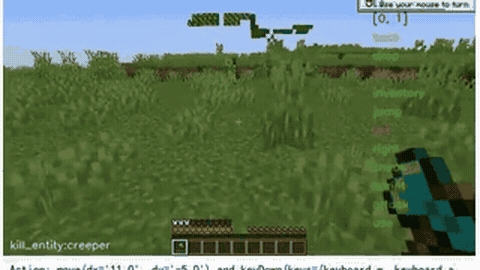

# Game-TARS

Game-TARS is a VLM game agent with sparse thinking, evaluated paused on Minecraft, web games and ViZDoom.

*Recording from the authors' pre-recorded Minecraft montage, cropped to the kill_entity:creeper panel, showing the agent's per-step Action line (mouse move plus keyDown) as it kills the creeper and earns the Monster Hunter advancement; no clock is shown, so it does not reveal whether the game paused during inference. Source: [ByteDance Seed, Game-TARS page](https://seed-tars.com/game-tars).*

| | |
|---|---|
| Year | 2025 |
| Links | [arXiv 2510.23691](https://arxiv.org/abs/2510.23691) |
| Demo | [Game-TARS page](https://seed-tars.com/game-tars): project page with pre-recorded montage videos of agent rollouts in Minecraft and unseen web/Windows games, with per-step Thought/Action text. The videos do not show whether the game kept running or was paused during inference. Human-playable: no. Live model: no. |
| Category | RL and decision model / post-training |
| Method | sparse thinking |
| Evaluated on | Minecraft, web games, ViZDoom |
| Evaluation play mode | paused-live |
| Basis | paper §5 footnote: web games "used time-pause to ensure causal interaction"; MCU and ViZDoom are synchronous simulators |
| What is trained (post-training table) | VLM; sparse thinking |
| Method (post-training table) | imitation, thoughts kept only where a reflex model fails |
| Basis (post-training table) | paper §5 footnote "used time-pause to ensure causal interaction" |

## Details

- **Game-TARS sparse thinking.** Keep a thought only at timesteps where an action-only model mispredicts the human action, and only if the thought leads to the right action. 37 tokens per step against 68. A ready data-construction rule for "reason only when needed". Evaluated paused.

## Demo

- [video] [Game-TARS blog page](https://seed-tars.com/game-tars) — Loaded the ByteDance Seed post (Oct 24, 2025) and seeked its two recorded montages, game-tars-minecraft-2.mp4 (45.6 s) and game-tars-unseen.mp4 (40.4 s), to 5/30/60/90%; the network log shows only static mp4 files and analytics, no model calls. The Minecraft video has four panels (kill_entity:fox, kill_entity:creeper, craft_item, mine_block:terracotta) with action-log overlays such as "Action: move(dx='0.0', dy='-2.0')" and keyDown(...); the unseen-games grid (Racing, Temple Run, Plane in the Air, Jump Only, Vizdoom Battle-1/2, Chaze Horizon, Stardew Valley and other Windows games) shows per-tile Chinese "Thought:" text and "Action:" lines (keyPress, mouseMove). Caption: "GameTARS can follow human instructions, reason and play unseen games on web, OS, and simulators." Play-mode evidence (recording): agent runs, but nothing on screen (latency, tick counter, clock) shows whether the game kept running or was paused; the page copy claims "Human-Native Real-Time Interaction" and a "sparse ReAct" pattern. Links go to arXiv 2510.23691, the UI-TARS GitHub repo and UI-TARS-1.5-7B weights (not Game-TARS weights).

Visited 10 November 2026 in a headless browser.

## What the team could reuse

- Data recipes: sparse thinking (from the post-training reuse list).

Related: [Game-TARS game suite](../environments/game-tars.md) (environment details); [UI-TARS-2](ui-tars-2.md); [ViZDoom](../environments/vizdoom.md); [MCU / MineStudio](../environments/mcu-minestudio.md)
