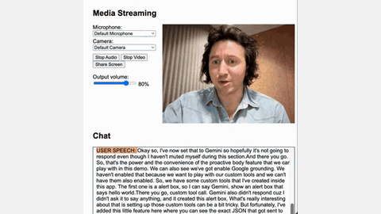

# Gemini Live (2.5, 3.1 Flash Live)

Gemini Live is Google's live streaming API with a `thinkingLevel` setting whose default is minimal.

*Screen recording at normal speed from Google Cloud's Live API demo walkthrough: the presenter talks to Gemini Live over a live mic and webcam stream, and the model calls the app's custom CSS tool, which turns the page background red. Source: [Google Cloud, "Live API plain js demo walkthrough" (YouTube)](https://www.youtube.com/watch?v=RLM1Qsp64WU).*

| | |
|---|---|
| Year | 2025-26 |
| Links | [docs](https://ai.google.dev/gemini-api/docs/live-guide) |
| Demo | [Gemini Live docs](https://ai.google.dev/gemini-api/docs/live): AI Studio Live needs sign-in and there is no public game-playing demo. The closest is Google's [Real-Time Gaming Guide](https://cloud.google.com/blog/topics/developers-practitioners/how-to-use-gemini-live-api-native-audio-in-vertex-ai) (code plus [video](https://www.youtube.com/watch?v=RLM1Qsp64WU)), where a human plays and Gemini Live gives spoken advice from the streamed screen; human-playable: no hosted version. |
| Category | realtime architecture |
| Method | `thinkingLevel`, default minimal |
| Evaluation play mode | realtime-live (speech) service |
| Open source | API only |
| Basis | docs: Live API overview and capabilities guide (saved); video at most 1 frame per second |
| Channels (in / out) | audio, video frames, text / audio, text |
| Tick | session streaming |

## Details

- **Realtime APIs.** In the OpenAI Realtime API and Gemini Live, interactivity is largely in the harness (voice activity detection, turn detection), not learned full duplex. In Realtime-Bench, GPT-Realtime-2 scores 12-18% and Gemini 3.1 Flash Live 6-18% under wall clock: quick but not good enough. Proactive audio is configurable on Gemini 2.5 Flash Live, permanently on for the 3.8 Live models and not supported on 3.1 Flash Live Preview (Live API capabilities guide, saved).

## Demo

- [project-page] [Gemini Live API docs](https://ai.google.dev/gemini-api/docs/live) — Loaded the page (redirects to aistudio.google.com/docs/live-api): an overview with a diagram of an app streaming text, audio and video over a WebSocket, buttons to try it in Google AI Studio or clone example apps, and listed gaming use cases (NPCs, in-game help assistants, translation of in-game content). No game demo.
- [dead-or-unreachable] [AI Studio Live](https://aistudio.google.com/live) — Redirects to Google Accounts sign-in; not signed in, so no evidence.
- [project-page] [Gemini Live on Vertex AI blog](https://cloud.google.com/blog/topics/developers-practitioners/how-to-use-gemini-live-api-native-audio-in-vertex-ai) — Read the "Real-time video game assistant" section: a "Real-Time Gaming Guide" React app (code under GoogleCloudPlatform/generative-ai/gemini/multimodal-live-api) with a [YouTube walkthrough](https://www.youtube.com/watch?v=RLM1Qsp64WU) that streams the player's screen and microphone to Gemini Live, which gives spoken hints in personas such as "Wise Wizard" or "Commander". Play-mode evidence: a human plays and the model only advises; it never controls the game, and the post shows no latency or tick counters.
- [project-page] [Live API Web Console](https://github.com/google-gemini/live-api-web-console) — Loaded the GitHub README (checked alongside openai/openai-realtime-console): a self-hosted starter (WebSocket, mic/webcam/screen streaming) that needs your own API key; no hosted instance and no game.

Visited 10 November 2026 in a headless browser.

## What the team could reuse

- Baselines for the "interaction/realtime models" column: Gemini Live through its API. Game pixels must be pushed as frames, and actions must be parsed from text or speech.

Related: [Realtime-Bench](../environments/realtime-bench.md); [gpt-realtime-2](gpt-realtime-2.md)
