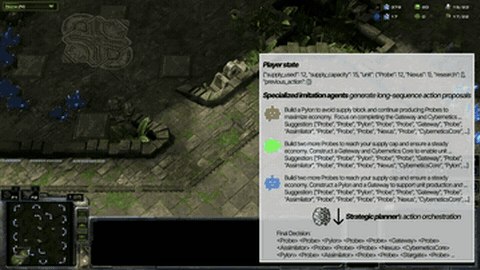

# HIMA

HIMA is a scaffold in which small fine-tuned agents propose long build sequences and a planner is called about 11 times a game in StarCraft II.

*Recording of a HIMA vs built-in Elite AI StarCraft II game in the replay viewer at "Faster x4" (sped up; in-game clock bottom-left of the minimap), with an edited overlay of the player state, three imitation agents' build-order proposals and the planner's final decision. Source: [HIMA official video (YouTube)](https://www.youtube.com/watch?v=AEqLN2pz9ns).*

| | |
|---|---|
| Year | 2025 |
| Links | [arXiv 2508.06042](https://arxiv.org/abs/2508.06042) |
| Demo | [project page](https://dcahn12.github.io/projects/hima) with an embedded official [YouTube video](https://www.youtube.com/watch?v=AEqLN2pz9ns) (4:37) of one HIMA vs built-in Elite AI StarCraft II game, narrated and overlaid with the agents' proposals and the planner's decision. A recording shown in the SC2 replay viewer at "Faster x4", not live and not human-playable. |
| Category | scaffold / post-training |
| Method | Small fine-tuned agents propose long build sequences; planner called about 11 times a game |
| Evaluated on | StarCraft II |
| Evaluation play mode | paused-live by default (`--realtime` off); realtime-live with the flag |
| Results | 100% to 16% across AI levels 4-10 |
| Basis | code: `main.py:23` `--realtime` default False, `main.py:70` `run_game(realtime=args.realtime)`; paper does not say which mode produced the win rates |
| What is trained (post-training table) | Qwen-2 1.5B + LoRA |
| Method (post-training table) | imitation of pro replays |
| Evaluation play mode (post-training table) | paused-live by default |
| Basis (post-training table) | code: `main.py:23` `--realtime` default False |

## Demo

- [video] [HIMA project page](https://dcahn12.github.io/projects/hima) — Opened the page, played the embedded YouTube video "StarCraft II Game Play between Ours(HIMA) and Built in AI(Elite)" (channel San Kim, 4:37) and jumped through it, capturing frames at 0:31, 1:25, 2:20, 3:17, 4:12 and 4:36. It shows one Protoss game on Ancient Cistern LE, "로컬 플레이어" (local player) vs "Computer". At 0:31 (in-game clock 1:35) an overlay shows the "Player state" JSON (`"supply_used": 12, "supply_capacity": 15`), three "Specialized imitation agents" with build-order suggestions, and the "Strategic planner's action orchestration" "Final Decision" (`<Pylon> <Probe> <Probe> <Gateway> ...`), with narration captions ("This hierarchical structure enables long horizon planning"). Later frames show plain gameplay (Robotics Facility at in-game 8:49 at video 2:20; Stargate warp-ins and a fight at in-game 15:58 at video 4:12). The page also has a static HIMA.gif illustration and result tables. The repo [snumprlab/hima](https://github.com/snumprlab/hima) sets no homepage. Play-mode evidence (recording): the SC2 replay control panel reads "Faster x4", so this is a game replay sped up and edited. About 16 in-game minutes fit in about 4.5 video minutes. The video does not show whether the game was played with `--realtime` on, so it does not settle the paused-live vs realtime-live question.

Visited 10 November 2026 in a headless browser.

Related: [PySC2 / python-sc2](../environments/pysc2-python-sc2.md); [SwarmBrain](swarmbrain.md)
