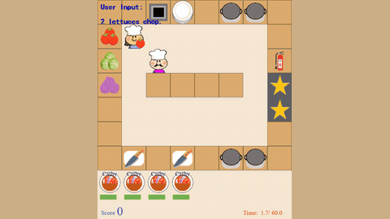

# HLA

HLA is a scaffold with a slow LLM, a fast LLM and a scripted executor, playing Overcooked with humans at about 3 Hz.

*Recorded replay from the authors' scripted-command test (Quantity Specification case 2): the script tester types "2 lettuces chop.", and HLA (the AI chef) fetches and chops lettuce and reports progress in the "AI Output" line while the game timer runs from about 2 to 10 s of 60. The authors' GIF plays faster than real time (about 1.3x). Source: [HLA project page](https://sites.google.com/view/overcooked-hla/).*

| | |
|---|---|
| Year | 2023 |
| Authors / org | Liu et al. |
| Links | [arXiv 2312.15224](https://arxiv.org/abs/2312.15224) |
| Demo | [project page](https://sites.google.com/view/overcooked-hla/): a static Google Site of recorded GIF replays comparing HLA with its ablations (scripted-command tests captioned with wall-clock completion times such as 'Success in 19.7s', plus replays of 4 human-study players who chat or speak). The recordings show the game clock running while the model acts in real time (the slow-LLM ablation lets soups burn). Human-playable: no. |
| Category | scaffold |
| Method | Slow LLM + fast LLM + scripted executor |
| Evaluated on | Overcooked with humans, about 3 Hz |
| Evaluation play mode | realtime-live (paper; no code) |
| Results | Macro latency 1.07 s against 4.16 s slow-only |
| Open source | no code |
| Basis | paper §1: Overcooked where "players collaborate at a rate of approximately 3Hz"; executor acts while the LLMs run; no pause described |

## Details

- **HLA** (Liu et al., AAMAS 2024). Slow Mind (GPT-3.5) for intent and chat, Fast Mind (quantised Llama-2-13B) for macro actions, scripted executor for atomic actions. Reports latency per level: 0.08 s atomic, 1.07 s macro.

## Demo

- [replay-viewer] [HLA project page](https://sites.google.com/view/overcooked-hla/) — Scrolled the whole Google Site and checked its media (44 animated GIFs and 4 PNGs, no video), and compared frames of the section 6.1 GIFs at 0, 4 and 8 s. Sections 4-5 compare NEA, SMOA, FMOA and HLA on scripted commands such as "3 chopped tomatoes please" and "Chop 2 Onions" then "Chop it again", captioned with wall-clock results like "Success in 42.9s", "Success in 19.7s" or "Failed"; section 6 replays four human-study players (Player-128 silent, 322 speaking, 221 and 421 texting) on maps Ring, Bottleneck, Partition and Quick, with a HUD ("Listen:False Speak:False Display:True") and an "AI Output:" chat line. Play-mode evidence (recordings): the page contrasts HLA, which "act[s] most swiftly", with SMOA (slow LLM only), which "takes much longer time" and lets soups burn, and the human partner keeps moving independently, so the game did not wait for the model. Nothing runs live or is playable; the page links code at github.com/HosnLS/Hierarchical-Language-Agent.
- Note: the file labels evaluation play mode as "realtime-live (paper; no code)", but the project page links a code repository (github.com/HosnLS/Hierarchical-Language-Agent; not visited).

Visited 10 November 2026 in a headless browser.

## What the team could reuse

- Harness pieces: per-level latency reporting (from the scaffolds reuse list).

Related: [HLA Overcooked](../environments/hla-overcooked.md) (evaluated on; environment details); [DPT-Agent](dpt-agent.md)
