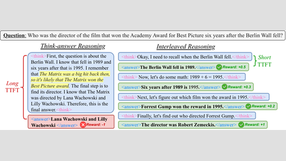

# Interleaved Reasoning

Interleaved Reasoning trains an LLM with RL that rewards correct intermediate answers.

*Paper figure (diagram): standard think-then-answer reasoning gives a long time to first token (TTFT) and a wrong final answer, while interleaved reasoning emits rewarded intermediate answers after short think steps. Source: [Xie et al., Interleaved Reasoning for Large Language Models via Reinforcement Learning, Figure 1](https://arxiv.org/abs/2505.19640).*

| | |
|---|---|
| Year | May 2025 |
| Links | [arXiv 2505.19640](https://arxiv.org/abs/2505.19640) |
| Demo | None found (searched: arXiv abstract page (no comments field or code links), Apple ML Research page (abstract only, no media), NeurIPS 2025 workshop poster page ("Project Page" links to OpenReview), web search for demo, GitHub repo, project page and video) |
| Category | post-training |
| Method | RL rewarding correct intermediate answers |
| Evaluated on | QA |
| Evaluation play mode | static |
| Basis | paper §1: five datasets; TTFT on fixed questions |
| What is trained | LLM |

## Demo

- None found. The arXiv abstract page has no comments field and no code or project links. The [Apple ML Research page](https://machinelearning.apple.com/research/interleaved-reasoning) has only the abstract and a "View publication" link, with no video or demo. The [NeurIPS 2025 workshop poster page](https://neurips.cc/virtual/2025/poster/127957) has a "Project Page" link, but it points to [OpenReview](https://openreview.net/forum?id=zjUMT9uu68). Web searches found no GitHub repo, Hugging Face Space or video.

Searched 10 November 2026; no demo found.
