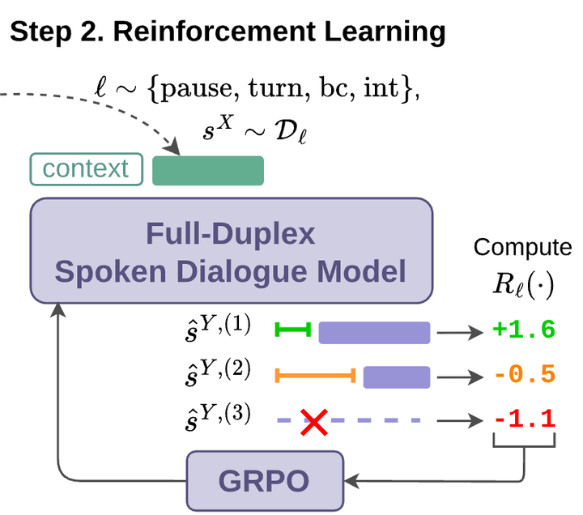

# Kyutai interactivity alignment

Kyutai interactivity alignment runs GRPO on the text stream of Moshi and PersonaPlex with rule-based timing rewards and a KL anchor.

*Figure from the paper: a conversation context goes into the full-duplex speech model, its sampled replies are scored with timing rewards (+1.6, -0.5, -1.1) and the scores feed back through GRPO. Source: [Figure 1 from Ohashi, Zeghidour, Defossez, Kharitonov (Kyutai), arXiv 2606.11167](https://arxiv.org/abs/2606.11167).*

| | |
|---|---|
| Year | Jun 2026 |
| Authors / org | Ohashi, Zeghidour, Defossez, Kharitonov |
| Links | [arXiv 2606.11167](https://arxiv.org/abs/2606.11167) |
| Demo | [Kyutai blog post with audio samples](https://kyutai.org/blog/2026-06-10-interactivity): recorded side-by-side audio of base vs post-trained Moshi and PersonaPlex, with two-track (user/examiner and model) waveform players, for Full-Duplex-Bench v1 axes and v2 real-time dialogues with GPT-Realtime. Recordings only; no live model or human-playable demo. |
| Category | post-training |
| Method | GRPO with rule-based timing rewards |
| Evaluated on | Full-Duplex-Bench v1, v2 |
| Evaluation play mode | realtime-live (speech) |
| Basis | paper §1: GRPO on conversation segments; evaluated on Full-Duplex-Bench v1 (pre-recorded) and v2 (real-time) |
| What is trained | Moshi, PersonaPlex text stream |

## Details

- **Kyutai interactivity alignment** (Ohashi, Zeghidour, Defossez, Kharitonov). GRPO on the text stream only, with rule-based timing rewards computed from sampled continuations (pause handling, response delay, backchannel timing) and a KL anchor to the frozen model. Moshi interruption latency 1.377 s to 0.461 s; PersonaPlex turn-taking latency 0.219 s to 0.079 s. The closest published analogue of the project's post-training for realtime play (see the [home page](../README.md)); the recipe transfers if the reward is a game score and the segment is a short episode.

## Demo

- [audio-samples] [Kyutai blog post "Post-training speech models for better interactivity"](https://kyutai.org/blog/2026-06-10-interactivity) (linked as "Blog post & audio samples" from the [moshika-rl-seamless model card](https://huggingface.co/kyutai/moshika-rl-seamless)) — Rendered the page, declined cookies, and pressed Play on the intro preview and on the v2 "Daily" Moshi sample; the playhead advanced across the waveform. Each player shows two stacked waveforms (USER/EXAMINER in grey, MODEL in green) and plays static WAV files (network: `V00_S1756_I00000667_human.wav`, `..._moshika.wav`, `..._dee3429b.wav`). Sections: an intro preview where "the same user input is fed to the base Moshi and to our post-trained variant"; Full-Duplex-Bench v1 samples under Backchanneling / User Interruption / Pause Handling tabs; and v2 samples, "cherry-picked" and "randomly sampled" (seed 0, indices [25, 49, 27, 3, 17, 33, 32, 26]), under Daily / Correction / Entity Tracking / Safety tabs, from "60-second real-time dialogues with GPT-Realtime". Caption example: "The base model only produces fragmented responses such as backchannels, whereas our models take turns appropriately". Play-mode evidence (recording): the v2 clips are recorded full-duplex dialogues in which the model and examiner overlap in time, which is consistent with the realtime-live (speech) label; there is no live model endpoint and nothing a human can talk to on the page.

Visited 10 November 2026 in a headless browser.

## What the team could reuse

- Reward shaping: Kyutai's rule-based timing rewards with a KL anchor (from the post-training reuse list).

Related: [Moshi](moshi.md); [PersonaPlex](personaplex.md); [Full-Duplex-Bench](../environments/full-duplex-bench.md) (evaluated on)
