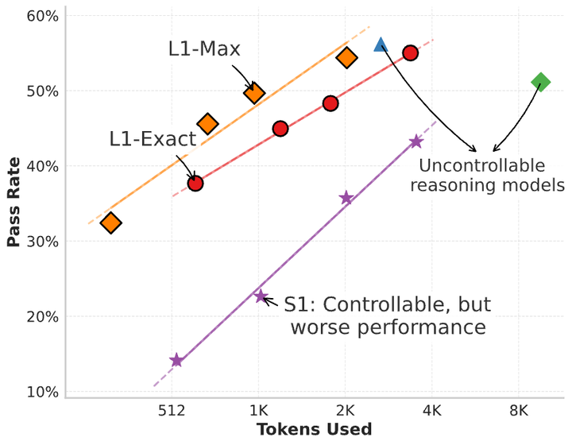

# L1

L1 trains a reasoning LLM with an RL reward minus the deviation from a length target.

*Figure 1 of the paper (a result plot): pass rate against tokens used for L1-Exact and L1-Max at several length targets, compared with S1 budget forcing and uncontrollable reasoning models. Source: [Aggarwal and Welleck, arXiv 2503.04697](https://arxiv.org/abs/2503.04697).*

| | |
|---|---|
| Year | Mar 2025 |
| Links | [arXiv 2503.04697](https://arxiv.org/abs/2503.04697) |
| Demo | [project page](https://cmu-l3.github.io/l1): a static viewer of pre-recorded L1-Exact/L1-Max math reasoning traces at fixed token budgets (512 to 3600), loaded from a JSON file. It shows no live model and no game. Human-playable: no. |
| Category | post-training |
| Method | RL reward minus length-target deviation |
| Evaluated on | math |
| Evaluation play mode | static |
| Basis | paper §4 experimental setup (math) |
| What is trained | reasoning LLM |

## Demo

- [project-page] [L1 project page](https://cmu-l3.github.io/l1) — Loaded the page and clicked "Load Example" in the "Interactive Model Comparison" widget with the dataset on AIME. It loaded aime_15 (correct answer 073) and showed L1-Exact at 512 tokens marked Incorrect (answered 687) beside L1-Max at 3600 tokens marked Correct; budgets offered are 512, 1024, 2048 and 3600 tokens across AIME, MATH, AMC and OlympiadBench. Play-mode evidence: the outputs are pre-recorded; the only request was a GET for static/data/comparison_data.json, with no inference call or streaming (console: "Updating token references from 3600 to 4096"). Static math reasoning, no game or environment clock. Links to arXiv, GitHub, the l3lab HF collection and a Colab notebook (sign-in needed, not run).

Visited 10 November 2026 in a headless browser.