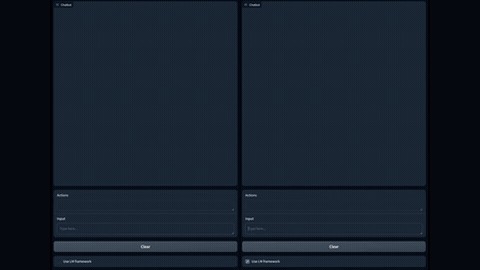

# LiveMind

LiveMind infers on a partial prompt while input streams.

*Screen recording of the official Gradio demo, sped up 20x (full 110 s clip): as a word problem is typed in, LiveMind (right) fills its Actions box with partial inferences and answers in one line once input ends, while conventional chain-of-thought (left) waits and then writes a long answer. Source: [LiveMind README demo video](https://github.com/ChuangtaoChen-TUM/LiveMind).*

| | |
|---|---|
| Year | Jun 2024 |
| Links | [arXiv 2406.14319](https://arxiv.org/abs/2406.14319) |
| Demo | [README demo video](https://github.com/ChuangtaoChen-TUM/LiveMind) (official 1:50 Gradio screen recording) — conventional CoT and LiveMind side by side on a math word problem typed in as streaming input. It is a recording of streaming text input, not a game against a clock. The repo's Gradio playground runs locally only; there is no hosted version. |
| Category | scaffold |
| Method | Infer on a partial prompt while input streams |
| Evaluated on | MMLU |
| Evaluation play mode | static |
| Results | Latency -84% |
| Basis | paper §4.1 "Streaming input simulation" |

## Demo

- [video] [LiveMind README demo video](https://github.com/ChuangtaoChen-TUM/LiveMind) (asset 5670677b-7030-4584-b65d-4ee702c2d021) — Opened the repo page and seeked the embedded 1:50 (110 s, 1188x848) video to 0:27, 0:55, 1:22 and 1:49, taking screenshots. The caption reads "A Demo with gradio of conventional Chain-of-Thought inference (left) and LiveMind simultanous inference (right) with streaming input". Both panes receive the same garden-cost word problem typed in character by character. While the user is still typing, the right (LiveMind) pane's "Actions" box fills with "action inference." lines, for example "Emily needs to budget $700 for the fencing". The left pane stays empty until the prompt is complete. At 1:22 the left pane has started its CoT ("Let") and the right shows "processing \| 0.6/6.4s". At 1:49 the right pane has given a one-line answer ("at least $2600") and the left has finished a long step-by-step answer ending "$2600". Play-mode evidence (recording): latency is measured against the end of the streaming input, with no game or environment clock. The interactive playground (`run_playground.py`) needs local Llama weights or an OpenAI key and has no hosted version (the arXiv page lists no Space or demo).

Visited 10 November 2026 in a headless browser.
