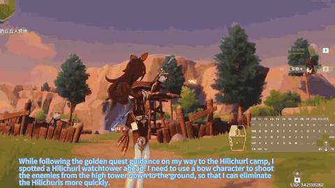

# Lumine

Lumine is a Qwen2-VL-7B game agent for Genshin Impact that perceives at 5 Hz, thinks sparsely and acts in 30 Hz action chunks.

*Recording of Lumine playing Genshin Impact: its inner monologue appears as a subtitle (planning to shoot the Hilichurl watchtower with a bow character), and the keyboard-and-mouse overlay lights up as it fires and then runs toward the camp. Source: [Footage: ByteDance Seed, Lumine project (lumine-ai.org), Mondstadt main-story playthrough on YouTube.](https://www.youtube.com/watch?v=C5y_5tFlhi0).*

| | |
|---|---|
| Year | 2025 |
| Authors / org | ByteDance Seed |
| Links | [arXiv 2511.08892](https://arxiv.org/abs/2511.08892) |
| Demo | [Lumine](https://www.lumine-ai.org/): project page with short recorded task clips and full-length YouTube playthroughs (Genshin Mondstadt 5h, Liyue 7h, Star Rail 7h at 4x, Wuthering Waves 1h46m); one combat clip shows the in-game timer running. All recorded video, with no live model or replay viewer; human-playable: no. |
| Category | RL and decision model / post-training |
| Method | 5 Hz perception, 30 Hz action chunks, 114 ms to first action |
| Evaluated on | Genshin Impact |
| Evaluation play mode | realtime-live (missions) + paused-live (141-task benchmark, all agents) |
| Basis | paper App.: "All the experiments are run in a real-time setting"; §5: "we pause the game during inference following the setup in Cradle" |
| What is trained (post-training table) | Qwen2-VL-7B; hybrid think-or-act |
| Method (post-training table) | imitation (1,731 h play, 15 h annotated reasoning) |
| Evaluation play mode (post-training table) | realtime-live (missions) + paused-live (141-task benchmark) |
| Basis (post-training table) | paper App.: "All the experiments are run in a real-time setting"; §5 "we pause the game during inference following the setup in Cradle" |

## Details

- **Lumine** is the most complete public description of an LLM that perceives, thinks sparsely and acts in real time: one frame per 200 ms, six 33 ms action chunks per step streamed as decoded, KV-cache reuse, quantisation, 25x latency reduction. The paper states its experiments run in a real-time setting. Mondstadt Act I in 56 minutes against 53 for expert humans. Its frontier-model baselines were run paused "following Cradle" because API calls can take 30 s. The paper does not state a weights or code release.
- **Lumine** (ByteDance Seed). Three stages: 1,731 hours of human play, 200 hours instruction-labelled, 15 hours with annotated inner monologue. The model decides each step whether to think before acting and learns to think mainly at transitions. Thinking adds latency (234 ms to first action against 114 ms) and is sequential: think, then act. When to think is imitation-learned, not optimised against its time cost. In-domain ablation: 6.6% without thinking or history, 93.4% with both.

## Demo

- [project-page] [Lumine project page](https://www.lumine-ai.org/) — Scrolled the ByteDance Seed page, logged 24 looping MP4 clips (7-87 s, 1280x720) from cloud.video.taobao.com and 6 YouTube iframes, seeked 8 clips to their midpoint and resolved the YouTube titles via oEmbed (the YouTube videos were not played). It describes a VLM agent seeing pixels at 5 Hz and outputting 30 Hz keyboard-mouse actions with adaptive reasoning; full playthroughs on YouTube: Genshin Mondstadt Act I (56 min), Act II and III (4h43m), Liyue Act I (7h16m, "edited version"), Honkai: Star Rail Herta Space Station (7h18m, "4x speed") and Wuthering Waves (1h46m); short clips cover combat, boss fights (Electro Hypostasis, Stormterror), puzzles, NPC talk, GUI use and complex instructions. Play-mode evidence (recording): the page says the agent acts "in real time" and one combat clip shows the in-game timer running (00:33 in a domain challenge), consistent with unpaused play; no latency readout, and the paper's paused 141-task benchmark is not shown.

Visited 10 November 2026 in a headless browser.

Related: [Lumine evaluation settings](../environments/lumine.md) (environment details); [Cradle](cradle.md); [Game-TARS](game-tars.md)
