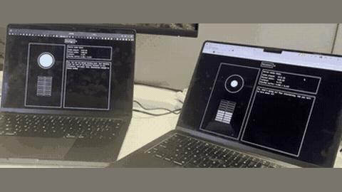

# Moshi

Moshi is a 7B text LLM over Mimi codec tokens that predicts user audio, its own audio and an "inner monologue" text stream every 80 ms.

*Recording (real-time, about 4.5 s) of two laptops running the Moshi web client during live conversations, each showing the audio orb, level meter, running transcript and a Server Audio Stats panel with latency and missed audio. Source: [Kyutai, Moshi release blog](https://kyutai.org/blog/2024-09-18-moshi-release).*

| | |
|---|---|
| Year | Oct 2024 |
| Authors / org | Kyutai |
| Links | [arXiv 2410.00037](https://arxiv.org/abs/2410.00037) |
| Demo | [Moshi live demo](https://moshi-chat.kyutai.org/) (moshi.chat now has an expired certificate): a live browser voice demo that needs a microphone; Moshi is a full-duplex speech-to-speech model (5-min sessions) that listens and talks continuously, and the [release blog](https://kyutai.org/blog/2024-09-18-moshi-release) has recorded videos of the web client with a 'Server Audio Stats' panel (latency about 0.1 s, missed audio). The follow-up [Unmute](https://unmute.sh/) ([explainer](https://kyutai.org/unmute/)) is a live STT -> LLM -> TTS cascade with editable character prompts. No game environment; human-playable: no game, but humans can talk to the live model. |
| Category | realtime architecture |
| Method | "Inner monologue" text stream, which is the transcript of its own speech |
| Evaluation play mode | realtime-live (speech) operation; reported evaluation static |
| Open source | Open weights and code |
| Basis | paper: abstract "theoretical latency of 160ms, 200ms in practice"; §5.6 continuations of 10 s Fisher prompts |
| Channels (in / out) | user audio / own audio + text |
| Tick | 80 ms (12.5 Hz), 17 streams |

## Details

- **Moshi** (Kyutai). A 7B text LLM over Mimi codec tokens. Each 80 ms step predicts 8 codebooks of user audio, 8 of its own audio and one text stream. 160 ms theoretical latency, about 200 ms in practice. The only mature open full-duplex backbone with a parallel text stream. Follow-ups: Hibiki (simultaneous translation), Unmute (a cascade that makes any text LLM listen and speak), PersonaPlex (NVIDIA; role and voice conditioning).
- Human reference numbers used as constraints: conversational turn gap about 230 ms (Moshi paper).

## Demo

- [live-model] [Moshi web demo](https://moshi-chat.kyutai.org/) — Loaded the page (moshi.chat now fails with ERR_CERT_DATE_INVALID; kyutai.org's "Talk to Moshi" links here), read the Settings panel (text temperature 0.7, text topk 25, audio temperature 0.8, audio topk 250, padding multiplier, repeat penalty) and clicked Connect with a fake microphone. The page says "Conversations are limited to 5 min. Moshi thinks and speaks at the same time." A WebSocket to wss://moshi-chat.kyutai.org/ opened and received only {"type":"connected"}; no conversation started within 25 s in headless mode (likely a queue or no real mic input), so a live session was not observed. Play-mode evidence: live full-duplex stream on a wall clock, no turn waiting; no game is involved.
- [video] [Moshi release blog](https://kyutai.org/blog/2024-09-18-moshi-release) — Seeked the two embedded recorded videos (moshi8.mp4, 56 s; moshi7.mp4, 45 s) at 10%, 50% and 90%. moshi8.mp4 is filmed footage of two laptops running the Moshi web client, each with the audio orb, level meter, running transcript and a "Server Audio Stats" panel (audio played, missed audio, latency about 0.1 s, buffer); moshi7.mp4 is a two-stream waveform visualization of a synthetic full-duplex conversation. Play-mode evidence (recording): the on-screen latency and missed-audio counters point to a real-time wall-clock audio stream where dropped audio is counted. The post links arXiv 2410.00037, GitHub and Hugging Face weights.
- [live-model] [Unmute](https://unmute.sh/) — Follow-up Kyutai system (no file of its own). Declined consent, picked the "Quiz show" preset, opened "More info" and clicked connect with a fake microphone for 25 s. The UI has 8 character presets, voice-sample upload, an editable "Instructions" system prompt and "download recording"; it is a cascade of Kyutai streaming STT with semantic VAD, an LLM (GPT OSS 120B) and Kyutai TTS 1.6B, where TTS can start before the LLM finishes. In headless mode connect opened no WebSocket (only /api/v1/health and /api/v1/voices were called), so no live session was observed. Play-mode evidence: live model, turn-taking by semantic VAD with latency described as under one second; no game.
- [project-page] [Unmute explainer](https://kyutai.org/unmute/) — Read the page and its animated STT -> LLM -> TTS pipeline diagram, which shows scripted word-by-word streaming text ("Oh, that's a big question! Um, Should I get a dog or a cat?"). It lists use cases including a "Digital dungeon master" for tabletop RPGs or Werewolf, and function calling (saying "bye" hangs up; Dev (news) pulls news through an API). Play-mode evidence: explainer animation only, scripted conversation.

Visited 10 November 2026 in a headless browser.

## What the team could reuse

- Baselines for the "interaction/realtime models" column: Moshi/PersonaPlex locally (from the architectures reuse list).
- Serialisation ideas for post-training a text model: a parallel inner-monologue stream.

Related: [PersonaPlex](personaplex.md); [Kyutai interactivity alignment](kyutai-interactivity-alignment.md)
