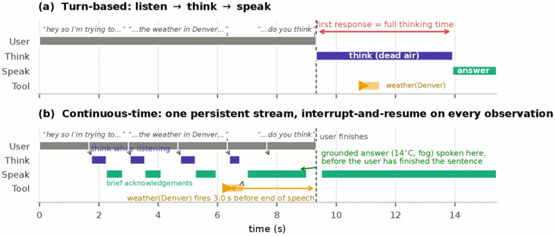

# Never Stop Thinking

Never Stop Thinking is an interrupt-and-resume orchestrator so a text LLM thinks while listening and speaking.

*Paper figure (diagram of a real trace at real timings) comparing a turn-based agent, which thinks in silence after the user finishes, with the continuous-time orchestrator, which thinks while listening and fires the weather tool 3 s before the user stops speaking. Source: [Never Stop Thinking, arXiv 2609.17416, Figure 1](https://arxiv.org/html/2609.17416).*

| | |
|---|---|
| Year | Sep 2026 |
| Links | [arXiv 2609.17416](https://arxiv.org/abs/2609.17416) |
| Demo | None found (searched: arXiv abstract page and HTML full text, the code link it gives (github.com/19PINE-AI/never-stop-thinking, which returns 404), the 19PINE-AI GitHub org repo list, and web searches for the paper name with "demo", "ReactiveBench" and "video") |
| Category | scaffold |
| Method | Interrupt-and-resume orchestrator so a text LLM thinks while listening and speaking |
| Evaluated on | ReactiveBench (voice scenarios) |
| Evaluation play mode | static (scripted interrupts, simulated speech rate) |
| Results | Latency -19% |
| Basis | paper §3: "interrupts are realized at the transcript level by truncating the agent's prior turn"; App. A simulated speech at 3.5 words/s |

## Demo

- None found. The arXiv abstract has no comments field and no project page. The HTML full text links code at github.com/19PINE-AI/never-stop-thinking, but that repo returns 404 (it is not public), and the 19PINE-AI org lists no repo with that name. Web searches turned up only the paper, Pine AI product pages and Bojie Li's talk slides on "continuous" thinking. None of these is a demo, video or replay of this work's orchestrator or of ReactiveBench.

Searched 10 November 2026; no demo found.
