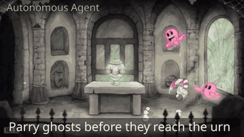

# NitroGen

NitroGen is a vision-to-gamepad model of about 500M parameters that outputs 16-action chunks from one frame, with no language.

*Recording of NitroGen playing Cuphead ("Parry ghosts before they reach the urn"), a 4 s clip from the authors' edited "Autonomous Agent" montage; no timer is shown and the page does not say whether the game was paused during inference. Source: [NitroGen project page (NVIDIA, Stanford, Caltech)](https://nitrogen.minedojo.org/).*

| | |
|---|---|
| Year | 2026 |
| Links | [arXiv 2601.02427](https://arxiv.org/abs/2601.02427) |
| Demo | [NitroGen page](https://nitrogen.minedojo.org/): project page with a pre-recorded montage captioned 'Autonomous Agent' (Rocket League, Cyberpunk 2077, Cuphead); the video does not show whether the game kept running or was paused during inference. Human-playable: no. Live model: no. The only Space found (community [blanchon/NitroGen-Pokemon](https://huggingface.co/spaces/blanchon/NitroGen-Pokemon)) was asleep. |
| Category | RL and decision model |
| Method | 16-action chunks from one frame; no language |
| Evaluated on | 1,000+ games, gamepad |
| Evaluation play mode | paused-live (clock frozen) |
| Basis | paper App. B.1 "freezes the game while the model predicts the next action"; code `nitrogen/game_env.py` `async_mode` pause/unpause per step |

## Details

- **NitroGen** (about 500M parameters, vision to gamepad, 40,000 hours of video) and **Open-P2P** (150M-1.2B, 8,300 hours of labelled keyboard/mouse data, open code and checkpoints) are the ready "fast but will not think" baselines. OmniGameArena and Realtime-Bench already include decision models alongside frontier VLMs.

## Demo

- [video] [NitroGen project page](https://nitrogen.minedojo.org/) — Loaded the NVIDIA/Stanford/Caltech page and seeked all four autoplay videos (banner.mp4 20 s, dataset.mp4 20 s, annotations.mp4 30 s, rollouts.mp4 50.4 s); only static mp4 files were requested. banner, dataset and annotations show internet gameplay with gamepad overlays and the input-overlay action-extraction pipeline; rollouts.mp4 is labeled "Autonomous Agent" and shows NitroGen playing Rocket League ("Fast flip to reach the ball first"), Cyberpunk 2077 driving ("Navigate city traffic") and Cuphead ("Avoid enemies to reach a coin"). Play-mode evidence (recording): an edited montage with no latency or tick display; the page does not say whether the game was paused during inference. Links to arXiv 2601.02427, HF dataset nvidia/NitroGen, model weights and GitHub MineDojo/NitroGen (local inference only, no hosted demo).
- [dead-or-unreachable] [NitroGen-Pokemon Space (community)](https://huggingface.co/spaces/blanchon/NitroGen-Pokemon) — Found under "Spaces using nvidia/NitroGen"; status was "This Space is sleeping due to inactivity" and it was not restarted, so no app ran. Two other community Spaces (dennny123/NitroGen-SuperstarSaga, err805/NitroGen-SuperstarSaga) were not opened.

Visited 10 November 2026 in a headless browser.

Related: [NitroGen universal simulator](../environments/nitrogen.md) (environment details); [Open-P2P](open-p2p.md); [OmniGameArena](../environments/omnigamearena.md)
