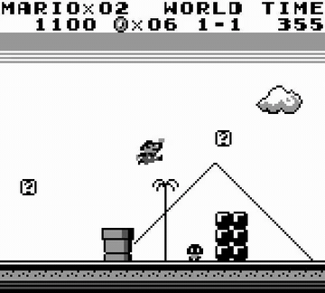

# Odysseus

Odysseus scales RL on a VLM to 100+ turn episodes with PPO and a lightweight turn-level critic.

*Recorded rollout of the Odysseus-trained Qwen3-VL-8B in Super Mario Land World 1-1 (5 s clip from the authors' 60 fps render, cropped to the game frame; the model's per-turn reasoning text beside it is cut off), with the in-game TIME counter visible. Source: [Odysseus project page](https://odysseus-project.github.io/).*

| | |
|---|---|
| Year | May 2026 |
| Authors / org | Princeton |
| Links | [arXiv 2605.00347](https://arxiv.org/abs/2605.00347) |
| Demo | [project page](https://odysseus-project.github.io/): side-by-side recorded gameplay videos, base Qwen3-VL-8B against Odysseus, on Super Mario Land (trained levels and off-policy or unseen start states) and Super Mario Bros (cross-game transfer), each with the model's per-turn perception, reasoning and answer text beside the frame. These are recordings, not a live model, and no part of the page is playable. |
| Category | post-training |
| Method | PPO with a turn-level critic over 100+ turns |
| Evaluated on | Super Mario Land |
| Evaluation play mode | paused-live |
| Basis | paper §3.3: "the chosen discrete action is repeatedly applied for a fixed number of consecutive frames" (15 for jumps, otherwise 5) |
| What is trained | VLM |

## Details

- **Odysseus** (Princeton). PPO with a lightweight turn-level critic scales RL on a VLM to 100+ turn episodes; at least three times the progress of frontier models in Super Mario Land. A candidate optimiser if a time cost is added.

## Demo

- [video] [Odysseus project page](https://odysseus-project.github.io/) (linked from the arXiv HTML; also links code [odysseus-project/odysseus-mario-training](https://github.com/odysseus-project/odysseus-mario-training) and [models](https://huggingface.co/collections/Odysseus-Project/odysseus)). I opened it in headless Chrome, played both videos in the default "Super Mario Land (Trained Levels)" / "World 1 Level1" / "Compare" view, and took frames at 10%, 50% and 90%. The page has three demo tabs: "Super Mario Land (Trained Levels)", "Super Mario Land (Off-policy and Unseen Scenarios)" and "Super Mario Bros (Cross-game Transfer)". The JS bundle lists 22 static MP4s, for example marioland-blackwhite-world1-level1-base_60fps.mp4 (27.9 s), marioland-blackwhite-world1-level1-score23450.0_60fps.mp4 (59.5 s) and mariobros-color-world4-level1-progress2419_60fps.mp4. Each video shows the Game Boy frame on the left and the turn's `<perception>`, `<reasoning>` and `<answer>` on the right, for example "<answer>['a', 'right']</answer>". In the trained-model video the in-game TIME counter reads 390 at 10%, 354 at 50% and 318 at 90%. Play-mode evidence (recording): the network log showed only static asset fetches and no model calls. The videos are 60 fps renders of turn-by-turn rollouts. Nothing on the page indicates that the emulator kept running while the model was generating, so this is consistent with the paused-live label.

Visited 10 November 2026 in a headless browser.

## What the team could reuse

- Optimisers: Odysseus PPO for long episodes (from the post-training reuse list).
