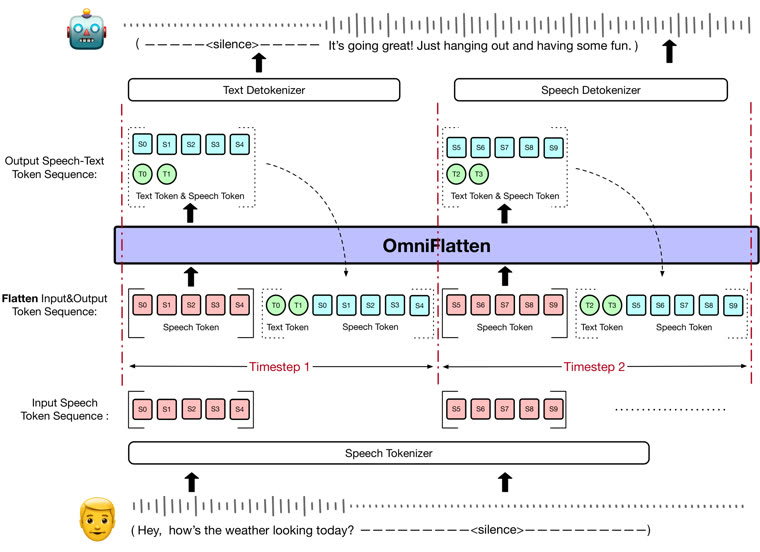

# OmniFlatten

OmniFlatten is staged post-training of a small GPT over flattened speech and text streams, with no architecture change.

*Paper figure (diagram) of the OmniFlatten architecture: each timestep's input speech tokens are interleaved with the model's own text and speech output tokens into one flat sequence for a single GPT, so it can listen and talk at once. Source: [OmniFlatten paper, Figure 1 (arXiv 2410.17799)](https://arxiv.org/html/2410.17799v2).*

| | |
|---|---|
| Year | 2024 |
| Links | [arXiv 2410.17799](https://arxiv.org/abs/2410.17799) |
| Demo | [project page](https://omniflatten.github.io/): static page with 5 recorded user-assistant voice-chat cases (40-116 s mp3s) with transcripts. No live model, no game and no Hugging Face Space; human-playable: no. |
| Category | realtime architecture |
| Method | Staged post-training of a small GPT, no architecture change |
| Evaluation play mode | offline replay |
| Open source | research |
| Basis | paper §4: "a predefined user speech input while setting a 1.5-second threshold" |
| Channels (in / out) | speech + text |
| Tick | flattened streams |

## Demo

- [project-page] [OmniFlatten project page](https://omniflatten.github.io/) — Opened the GitHub Pages site (Overview, Experiments, Cases, Metrics) and played case1.mp3 for 5 s. The Cases section has 5 tabs, each a recorded mp3 voice conversation (40 to 116 s) with a transcript of generic assistant chat (e.g. budgeting tools). Play-mode evidence: only static audios/case1-5.mp3 requests, no API or websocket traffic, and no latency or timing display; these are recorded examples, not live inference.

Visited 10 November 2026 in a headless browser.