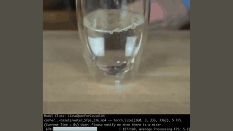

# OmniMMI / M4

OmniMMI / M4 is a streaming video LLM entry (the OmniMMI benchmark and its M4 model).

*Recording of the authors' local M4 demo (cropped to the lower part of the frame): the model watches a 5 fps video with the query "notify me when there is a mixer", and the terminal log shows the proactive alert "(Current Time = 23.6s) Assistant: The mixer appear at 20.6s". Source: [OmniMMI M4 page](https://omnimmi.github.io/m4.html).*

| | |
|---|---|
| Category | realtime architecture (streaming video LLM) |
| Demo | [M4 page](https://omnimmi.github.io/m4.html): two recorded screen captures of M4 running locally on a streaming video ("Proactive Generation Demo" with a mixer alert, "Proactive Turn-taking Demo" with an interrupting query); [project page](https://omnimmi.github.io) has benchmark example clips and a leaderboard. Recordings only; nothing live or human-playable. |

## Details

- **Streaming video LLMs** (VideoLLM-online, Flash-VStream, Dispider, StreamBridge, LiveCC, StreamingVLM, OmniMMI/M4, Proact-VL). The only "action" is when to speak. Evaluations replay recorded video and mostly score offline.

## Demo

- [official-video] [M4 page](https://omnimmi.github.io/m4.html) — seeked both videos and screenshotted frames. "Proactive Generation Demo" (demo_water_alert.mp4, 31.9 s; "Query: Please notify me when there is a mixer.") is a screen capture with a terminal log overlay: "Model Class: LlavaQwenForCausalLM", "water_5fps_336.mp4 -> torch.Size([160, 3, 336, 336]), 5 FPS", "119/160, Average Processing FPS: 5.4" and "(Current Time = 23.6s) Assistant: The mixer appear at 20.6s". "Proactive Turn-taking Demo" (demo_water_turntaking.mp4, 6.7 s) shows a terminal CLI chat over local_demo/assets/water.mp4 in which a new user query interrupts the model's answer. Play-mode evidence: recorded local runs that process frames at about the video's 5 fps and alert 3 s after the event; no live endpoint.
- [project-page] [OmniMMI project page](https://omnimmi.github.io) — six annotated benchmark clips (ap/sg/md/si/pa/pt.mp4) and sortable leaderboards listing M4 (Qwen2-7B, "32 / 1 fps", avg. w/o P 12.46, PA 25.50, PT 62.00); scores only, no replays.

Visited 10 November 2026 in a headless browser.

Related: [OmniMMI](../environments/omnimmi.md) (benchmark details); [VideoLLM-online](videollm-online.md)
