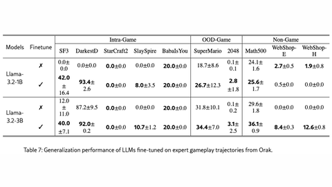

# Orak fine-tuning

Orak fine-tuning is SFT of small Llama models on LLM trajectories across Orak's 12 games.

*Table 7 of the paper (screenshot of the arXiv HTML version), comparing Llama-3.2-1B and 3B with and without SFT on Orak trajectories across in-domain games, out-of-domain games (Super Mario, 2048) and non-game tasks. Source: [Park et al., arXiv 2506.03610](https://arxiv.org/html/2506.03610v3).*

| | |
|---|---|
| Year | Jun 2025 |
| Links | [arXiv 2506.03610](https://arxiv.org/abs/2506.03610) |
| Demo | No demo specific to the fine-tuned models; the Orak [leaderboard](https://krafton-ai.github.io/orak-leaderboard/) Battle Arena tab lists Elo for SF3 and SC2 (Minitron-8B top in SF3 at 1680), and its two recorded GIFs show Claude (not the fine-tuned models) playing through MCP with the game paused between steps. Also a [YouTube promo](https://www.youtube.com/watch?v=2_tUJRrTYR0). Human-playable: no. |
| Category | post-training |
| Method | SFT on LLM trajectories |
| Evaluated on | 12 games |
| Evaluation play mode | paused-live |
| Basis | paper §5.4 and App.: "During LLM inference, we pause the Super Mario game environment" |
| What is trained | Llama-3.2-1B/3B |

## Details

- **Orak fine-tuning.** SFT of small Llama models on LLM trajectories lifts Street Fighter III from 12.0 to 40.0 paused. No fine-tuning aimed at the unpaused setting.

## Demo

- [leaderboard] [Orak leaderboard](https://krafton-ai.github.io/orak-leaderboard/) — Opened the page, clicked both tabs and downloaded its two GIFs (each 359 frames, 14.96 s). It is a static leaderboard (last updated 2025.06.09) of mean ± std scores across 12 games for about 20 model / agentic-strategy pairs (Gemini-2.5-pro first, average rank 3.9) and a 'Battle Arena' tab of Elo for SF3 and SC2 (Minitron-8B top in SF3 at 1680). The GIFs 'Claude playing Ace Attorney' (Claude 3.7 Sonnet) and 'Claude playing Baba Is You' (Claude Sonnet 4) are screen recordings of Claude Desktop calling MCP tools (load-obs, get-agent-module-prompts, send-agent-module-response, dispatch-final-action) beside the game window. Play-mode evidence (recording): in Baba Is You the game shows a 'PAUSE' overlay while Claude makes tool calls, then reports 'successfully completed one iteration... loading the new game state'; Ace Attorney shows step-by-step simulated key inputs ('Simulated GetKeyDown input detected for key: A') with the game idle between calls. Network requests were static files only; no replay viewer, interactive play or live model.
- [video] [Orak YouTube promo](https://www.youtube.com/watch?v=2_tUJRrTYR0) — Opened the KRAFTON promo 'Orak Benchmark / From Talking to Playing: Can LLMs Really Game?' (2:00) but it would not play in headless Chrome (embed Error 153, watch page stuck at 0), so only the thumbnail (a grid of game screenshots) was seen. Play-mode evidence: unknown; it is a promotional edit, not a live run.

Visited 10 November 2026 in a headless browser.

Related: [Orak](../environments/orak.md) (environment details)
