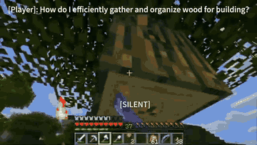

# Proact-VL

Proact-VL is a streaming video LLM that comments on gameplay but does not play.

*Recording from the authors' Guidance Assistance demo: while a human plays Minecraft, Proact-VL shows "[SILENT]" and then chooses to speak with advice on gathering wood (real-time, 6 fps excerpt). Source: [Proact-VL authors, YouTube](https://www.youtube.com/watch?v=awVtwRwB1CI).*

| | |
|---|---|
| Year | Mar 2026 |
| Links | [arXiv 2603.03447](https://arxiv.org/abs/2603.03447) |
| Demo | [project page](https://proact-vl.github.io) with three embedded YouTube demo videos (solo commentary on a League of Legends broadcast, multi-speaker commentary on a Counter-Strike 2 broadcast, Minecraft guidance) plus a [6.7 min overview video](https://youtu.be/IGD-2CO6-aQ): screen recordings of the model's subtitled commentary over prerecorded gameplay. The model never plays; no live demo, replay viewer or playable page. |
| Category | realtime architecture (streaming video LLM) |

## Details

- **Streaming video LLMs** (VideoLLM-online, Flash-VStream, Dispider, StreamBridge, LiveCC, StreamingVLM, OmniMMI/M4, Proact-VL). The only "action" is when to speak. Evaluations replay recorded video and mostly score offline. Proact-VL ([arXiv 2603.03447](https://arxiv.org/abs/2603.03447)) is the closest to games: it comments on gameplay but does not play.

## Demo

- [project page] [Proact-VL project page](https://proact-vl.github.io) — Rendered it and listed its media. No `<video>` or `<canvas>` elements and no model API calls. It has three YouTube iframes under "Demo Video", one per task type: "Solo Commentary", "Multi-Speaker Commentary" and "Guidance Assistance". It also links the paper, code (github.com/microsoft/AnthropomorphicIntelligence), the Hugging Face collection oaaoaa/aicompanion and a YouTube overview. Play-mode evidence: none beyond the recordings.
- [video] ["Proact-VL: Solo Commentary Demo"](https://www.youtube.com/watch?v=hEMyNKgxYT8) — Played the 83 s video, seeking to 8, 42 and 71 s. It is an LPL/LCK broadcast of BLG vs T1 in League of Legends (patch 25.13) with the model's commentary burned in as subtitles, for example "And now we're going to be looking at the Drake". Play-mode evidence (recording): the in-game clock runs (18:17 on screen); the model only comments on recorded esports footage and takes no actions; no latency overlay.
- [video] ["Proact-VL: Multi-Speaker Commentary"](https://www.youtube.com/watch?v=0eDwfPGm51w) — Played the 183 s video, seeking to 18, 92 and 156 s. It is a PGL Counter-Strike 2 grand final broadcast (PARIVISION vs Vitality) with subtitles tagged by speaker, for example "[Assistant 0]: And the first gun round for VITALITY goes the way of the CTs. They just got it." Play-mode evidence (recording): commentary on a prerecorded broadcast; no actions.
- [video] ["Proact-VL: Guidance Assistance"](https://www.youtube.com/watch?v=awVtwRwB1CI) — Played the 92 s video after a pre-roll ad, seeking to 2, 6, 10 and 13 s. It shows first-person Minecraft footage with the caption "[Player]: How do I efficiently gather and organize wood for building?" The model shows "[SILENT]" at 6 s, then at 13 s answers "[Assistant]: Open your inventory to check your tools; ensure you have enough storage space for your wood." Play-mode evidence (recording): the response is delayed until the model chooses to speak; a human plays and the model only advises.
- [video] ["Proact-VL: A Proactive VideoLLM for Real-Time AI Companions"](https://youtu.be/IGD-2CO6-aQ) — Played the 402 s overview, seeking to 40, 201 and 342 s. It shows the same BLG vs T1 League of Legends broadcast with commentary subtitles, for example "Even if he doesn't have the best stats, he's still one of the most". Play-mode evidence (recording): no latency or timing overlay.

Visited 10 November 2026 in a headless browser.

Related: [Proact-VL Live Gaming Benchmark](../environments/proact-vl-live-gaming.md) (benchmark details)
