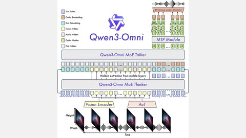

# Qwen3-Omni / Qwen3.5-Omni

Qwen3-Omni is a Thinker-Talker model in which thinking precedes streaming output.

*Architecture diagram (paper Figure 2): vision and AuT audio encoders feed the MoE Thinker, whose middle-layer hidden states drive the MoE Talker, an MTP module and a streaming codec decoder that emit speech. Source: [Qwen3-Omni Technical Report, arXiv 2509.17765](https://arxiv.org/html/2509.17765).*

| | |
|---|---|
| Year | Sep 2025 |
| Links | [arXiv 2509.17765](https://arxiv.org/abs/2509.17765) |
| Demo | [Hugging Face Space "Qwen3-Omni Demo"](https://huggingface.co/spaces/Qwen/Qwen3-Omni-Demo) (also on [ModelScope](https://modelscope.cn/studios/Qwen/Qwen3-Omni-Demo)): a Gradio chat with Online (mic/webcam recording) and Offline (text and file upload) tabs; in Nov 2026 a text query returned "Error". Also an official [launch video](https://youtu.be/_zdOrPju4_g). It shows general omni-modal chat, not a model playing a game against a running clock. |
| Category | realtime architecture |
| Method | Thinker-Talker; thinking precedes output |
| Evaluation play mode | static |
| Open source | Qwen3-Omni Apache-2.0 |
| Basis | paper (Qwen3-Omni) §1: "Across 36 audio and audio-visual benchmarks"; "theoretical end-to-end first-packet latency of 234 ms" |
| Channels (in / out) | audio, video, text / text, speech |
| Tick | streaming output |

## Demo

- [live-model] [Qwen3-Omni Demo HF Space](https://huggingface.co/spaces/Qwen/Qwen3-Omni-Demo) (linked from the [QwenLM/Qwen3-Omni](https://github.com/QwenLM/Qwen3-Omni) README with a [ModelScope mirror](https://modelscope.cn/studios/Qwen/Qwen3-Omni-Demo)) — Opened the running Gradio Space (HF API stage RUNNING), read both tabs and sent one text prompt on the Offline tab. The "Online" tab takes "Record Audio" and "Record/Upload Video" input (headless: "No microphone found") with voice choice, "Return Audio" and "Enable Thinking" toggles; the "Offline" tab is a text box with multimodal upload. The prompt went to gradio_api/queue/join and the chat showed "Error" after 30 s. Play-mode evidence: none; it is turn-based chat (record, then "Submit"), with no game or running clock.
- [video] [Qwen3-Omni: Natively Omni-Modal Foundation Models!](https://youtu.be/_zdOrPju4_g) (official Qwen channel, 6:35; a Chinese version is at [Wtjsw5deXfQ](https://youtu.be/Wtjsw5deXfQ)) — Loaded it and tried seeking to 20, 60 and 120 s; the frames captured showed the "Multilingual" language-list title card (Vietnamese, French, Chinese, English, Korean). The description says it "delivers real-time streaming responses in both text and natural speech". Play-mode evidence: promotional recording; no game play.

Visited 10 November 2026 in a headless browser.
