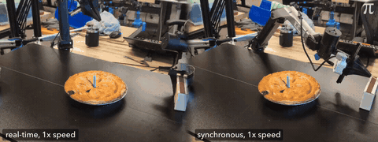

# Real-Time Chunking

Real-Time Chunking starts the next inference early, freezes the actions that will execute during the delay and inpaints the rest.

*Recording at 1x speed of a robot with real-time chunking (left) striking a match and lighting a candle on a pie, while the synchronous-inference robot (right) is still picking up the matchbox. Source: [Video: Physical Intelligence, "Real-Time Action Chunking with Large Models" (Black, Galliker, Levine), pi.website](https://www.pi.website/research/real_time_chunking).*

| | |
|---|---|
| Year | Jun 2025 |
| Links | [arXiv 2506.07339](https://arxiv.org/abs/2506.07339) |
| Demo | [RTC page](https://www.pi.website/research/real_time_chunking): recorded real-robot videos with latency labels ('~200ms/~300ms latency'), an animated diagram of the robot executing one action chunk while the next is computed, a latency table (139 ms mobile, 108 ms static) and throughput charts at +0/+100/+200 ms injected delay. No Kinetix demo, no interactive or live demo; human-playable: no. |
| Category | RL and decision model |
| Method | freeze committed prefix, inpaint the rest |
| Evaluated on | robots, Kinetix |
| Evaluation play mode | realtime-live (robot) + injected delay (sim) |
| Basis | paper §5: Kinetix benchmark with simulated inference delay plus 6 real bimanual tasks |

## Details

- **Real-Time Chunking**: start the next inference early; freeze the actions that will execute during the delay and inpaint the rest. No degradation with 200 ms of added delay on real robots; works above 300 ms.

## Demo

- [video] [Real-Time Chunking page](https://pi.website/research/real_time_chunking) — Loaded the page (redirects to www.pi.website), read the text and seeked the 2:17 sizzle.mp4 (a robot lighting a candle on a pie); recorded real-robot videos only, no live demo. It shows side-by-side temporal-ensembling failure clips labelled "~200ms latency" and "~300ms latency" (shirt folding), an animated "Thinking while moving" diagram of the previous chunk (green) executing while the next (red) is generated, a latency table (model 97 ms, network 21 ms, total 139 ms mobile and 108 ms static), and throughput and cumulative-progress charts for RTC vs synchronous execution at +0, +100 and +200 ms injected delay. Play-mode evidence: the robot keeps executing the old 50-action (1 s) chunk while the new one is inpainted; the text reports RTC handles more than 300 ms of inference delay and that synchronous inference pauses between chunks. An update dated Dec 8, 2025 links the training-time RTC follow-up used in the pi*0.6 espresso demo.

Visited 10 November 2026 in a headless browser.

Related: [Real-Time Chunking Kinetix benchmark](../environments/real-time-chunking-kinetix.md) (environment details); [Training-time RTC](training-time-rtc.md); [A2C2](a2c2.md)
