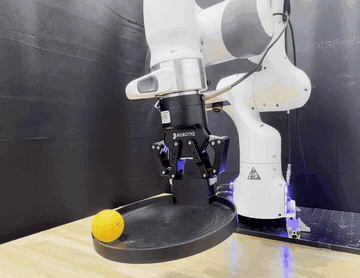

# Real-Time EXPO-FT

Real-Time EXPO-FT trains a small edit policy on top of a VLA with online RL on real robots at 30 Hz.

*Recording at 1x of a Real-Time EXPO-FT policy on a real Franka arm in the Ball Balancing task, tilting a tray to steer a ball to its centre (4.5 s excerpt, cropped). Source: [Real-Time EXPO-FT project page](https://pd-perry.github.io/real-time-expo-ft/).*

| | |
|---|---|
| Year | 2026 |
| Links | [arXiv 2609.18207](https://arxiv.org/abs/2609.18207) |
| Demo | [Real-Time EXPO-FT site](https://pd-perry.github.io/real-time-expo-ft/): project page with recorded real-robot rollout videos at 1x, with the physical world moving during inference, comparing the method against baselines with and without RTC. Robotics videos, not games; no Kinetix demo; human-playable: no. |
| Category | post-training |
| Method | online RL |
| Evaluated on | real robots at 30 Hz |
| Evaluation play mode | realtime-live |
| Basis | paper §3: delay of d timesteps; real-world dynamic tasks |
| What is trained | VLA + small edit policy |

## Demo

- [video] [Real-Time EXPO-FT project page](https://pd-perry.github.io/real-time-expo-ft/) — Loaded the page and seeked the 59.9 s teaser and the first rollout videos to 1 s and 5 s; all clips are pre-recorded mp4 files (e.g. /static/videos/rollout_videos/balance/ours.mp4). The teaser shows 4 real Franka tasks (Ball Balancing, Soccer Kicking, Dynamic Picking, Object Passing); the "Policy Rollouts" grid compares Real-Time EXPO-FT with RLPD, DSRL, EXPO-FT and BC, with and without RTC, in roughly 60 s clips marked "1x"; the Evaluation table gives e.g. Ball Balancing ours 28/30, EXPO-FT 23/30 w/ RTC and 18/30 w/o; training progress plays at 5x. Play-mode evidence (recording): page text says "Real robots do not pause for inference... the physical world keeps moving while the robot computes" and "Every clip below plays at 1x speed. Nothing is sped up or slowed down." No Kinetix demo on the page.

Visited 10 November 2026 in a headless browser.