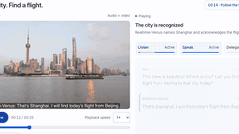

# Realtime-Venus

Realtime-Venus is a full-duplex model whose front-end delegates to a background harness.

*Screen capture of the authors' recorded "See the city. Find a flight." demo (00:12-00:19) on the project page, showing the Delegate status turning active and a Harness flight-search entry appearing while the conversation continues; real-time playback of a pre-recorded session. Source: [Realtime-Venus project page](https://realtime-venus.github.io/#demos).*

| | |
|---|---|
| Year | 2026 |
| Links | [arXiv 2609.13814](https://arxiv.org/abs/2609.13814) |
| Demo | [project page](https://realtime-venus.github.io/#demos): three recorded demo scenes (full-duplex speech with a user follow-up that overlaps the reply, a microwave beep spotted from audio and video, a flight search handed to the background harness), each with a timed transcript and Listen/Speak/Delegate status. Recordings of live real-time sessions, not a live model and not a game. |
| Category | realtime architecture |
| Method | Front-end model delegates to a background harness |
| Evaluation play mode | realtime-live (speech, Full-Duplex-Bench) + static |
| Open source | not checked |
| Basis | paper §6 evaluation tables |
| Channels (in / out) | audio, video / speech |
| Tick | full duplex |

## Demo

- [project page with recorded videos] [Realtime-Venus project page](https://realtime-venus.github.io/#demos) — I played all three scenes and moved through their timelines. Each is a pre-recorded file, with no model calls in the network log: `assets/demos/road-trip.m4a`, `microwave.mp4` (with `microwave.en.vtt` captions) and `shanghai-flights.mp4` (35.28 s). Next to each player is a transcript synced to the recording and Listen/Speak/Delegate status bars.
  - 01, "Change direction." (Realtime-Venus-Audio, 00:37): The model replies from 00:03 to 00:15, and the user's follow-up runs from 00:15 to 00:18, labelled "Your follow-up overlaps this response". At 00:17 the step was "4 / 6 Your follow-up continues".
  - 02, "Catch the beep." (Realtime-Venus-Omni, 00:45): The user asks "Let me know when the microwave beeps" (00:01-00:04), and the model speaks up unprompted at "00:30 · Watch the response".
  - 03, "See the city. Find a flight." (Omni, 00:35): A "Harness" entry, "Find suitable flights from Beijing to Shanghai today", runs from 00:14 to 00:24 while the conversation continues. At 00:24-00:33 the model reports "I found twelve flights. I'd recommend the 3:00 PM flight...".
  - Play-mode evidence: these are recordings of sessions that ran against a real-time clock, with timestamps showing overlapping speech, but the page itself does not run a model. The page also offers a beta Android APK ("Download Android APK Beta"), which I did not install. It has a further "Other work" video section (smart glasses, rings, phone) that is not part of this system's evaluation. None of the scenes is a game.

Visited 10 November 2026 in a headless browser.

Related: [Full-Duplex-Bench](../environments/full-duplex-bench.md)
