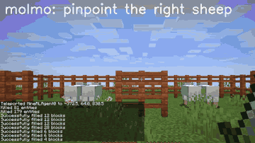

# ROCKET

ROCKET is a Minecraft model listed with the VPT line on the 20 Hz native interface with a synchronous simulator.

*Recorded ROCKET-1 rollout for the task "Hunt the sheep in the right fence", with Molmo pointing at the target sheep and ROCKET-1 then walking over and attacking it; played at 2x speed and cropped. Source: [ROCKET-1 project page, CraftJarvis](https://craftjarvis.github.io/ROCKET-1/).*

| | |
|---|---|
| Year | 2022-25 |
| Category | RL and decision model |
| Method | 20 Hz native interface; synchronous simulator |
| Evaluated on | Minecraft |
| Evaluation play mode | paused-live |
| Basis | paper (VPT) App. C: client and server "run in the same thread ... slower or faster than real time"; code: MineRL `_multiagent.py` synchronous token |
| Demo | [ROCKET-1 project page](https://craftjarvis.github.io/ROCKET-1/), [ROCKET-2 project page](https://craftjarvis.github.io/ROCKET-2/), [ROCKET-1 Hugging Face Space](https://huggingface.co/spaces/phython96/ROCKET-1-DEMO) (paused). Project pages with recorded Minecraft gameplay GIFs and official YouTube videos of a human steering the policy through a Gradio page by clicking target objects; the Gradio app steps the simulator in fixed step batches, not against a running clock, and the live Space is paused. |

## Demo

- [project page] [ROCKET-1 project page](https://craftjarvis.github.io/ROCKET-1/) — rendered and scrolled it; it has a "Demo" button, 7 embedded CraftJarvis YouTube videos (captioned "Videos of ROCKET-1 playing Minecraft." and "Playing with ROCKET-1 on Gradio."), labelled data-pipeline examples, and 19 gameplay GIFs. The teaser figure "Get The Obsidian" shows observation frames indexed o1 to o512 with interaction labels (use, approach, mine block, switch). Play-mode evidence: recorded clips only; the page says "GPT-4o and Molmo run at low frequencies, while SAM-2 and ROCKET-1 operate at the same frequency as the environment."
- [live demo, unavailable] [ROCKET-1-DEMO Hugging Face Space](https://huggingface.co/spaces/phython96/ROCKET-1-DEMO) — linked from the "Demo" button; opened it and it shows "This Space has been paused." (Docker Space, last modified 3 November 2024), so it could not be used.
- [official video] [[ROCKET-1] Playing Minecraft with ROCKET-1 on a Gradio Page](https://www.youtube.com/watch?v=qXLWw81p-Y0) (CraftJarvis, 3:52) — played it and sought to 7 s, 32 s and 60 s. The recorded Gradio UI has a Minecraft view, SAM-2 checkpoint choice, point clicking, interaction-type radio buttons (Approach, Interact, Hunt, Mine, Craft, Switch), "Reset Environment", "Manually Step", a step slider set to 20 with "Call Rocket", and a status line "Running Agent `Rocket` steps: 20/20." Play-mode evidence: the human picks a target and the agent runs a fixed batch of steps per call, so the simulator advances in steps and does not run against a wall clock.
- [official video] [[ROCKET-2] Human Interacting with ROCKET-2 in Minecraft](https://www.youtube.com/watch?v=y3jljKXaVOU) (CraftJarvis, 2:21), embedded on the [ROCKET-2 project page](https://craftjarvis.github.io/ROCKET-2/) under "Playing with ROCKET-2 on Gradio by specifying the target object from your own camera view." — played it and sought to 7 s, 32 s and 60 s. It shows a "Rollout by Gradio" view with the human's goal view and segmentation mask (red outline) above the agent's view with a key and mouse action overlay. Play-mode evidence: a recorded rollout; nothing indicates a running clock.

Visited 10 November 2026 in a headless browser.

Related: [VPT](vpt.md); [MineRL](../environments/minerl.md)
