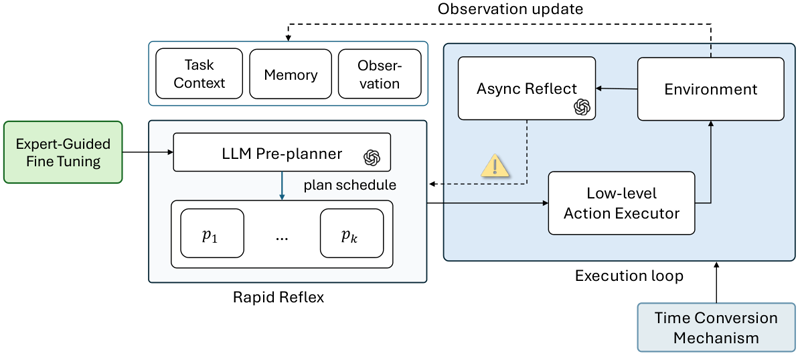

# RRARA

RRARA is a scaffold in which a rule reflex acts at once and an asynchronous LLM reflector corrects it.

*Method diagram (paper Figure 2): an LLM pre-planner caches a plan schedule that the rapid-reflex executor runs at once, while an asynchronous LLM reflector watches the environment and sends corrections, with the Time Conversion Mechanism advancing the execution loop by inference latency. Source: [Zheng et al., arXiv 2506.07223](https://arxiv.org/html/2506.07223).*

| | |
|---|---|
| Year | Jun 2025 |
| Authors / org | Zheng et al. |
| Links | [arXiv 2506.07223](https://arxiv.org/abs/2506.07223) |
| Demo | None found (searched: arXiv abstract page and comments ("Accepted by the CVPR 2025 Embodied AI Workshop", no project, code or video links), web search for the paper title, "RRARA" and "Time Conversion Mechanism" with demo, project page, GitHub and video) |
| Category | scaffold |
| Method | Rule reflex acts at once; asynchronous LLM reflector corrects |
| Evaluated on | HAZARD with injected latency |
| Evaluation play mode | realtime-live (INJECT) |
| Results | Value rate 0.44 against best plain LLM 0.25 |
| Open source | no code |
| Basis | paper §3: "After each decision, we advance the simulator by frames" (frames = latency x 30 FPS) |

## Details

- **RRARA** (Zheng et al.; no code). A rule policy acts immediately; a fine-tuned GPT-3.5 reflector vetoes or corrects asynchronously; a pre-planner caches subgoal sequences. Its Time Conversion Mechanism (advance the simulator by ceil(latency x FPS) frames) is reusable on its own.

## Demo

- None found. The arXiv abstract page (comments: "Accepted by the CVPR 2025 Embodied AI Workshop") links only the PDF, HTML and TeX source, with no project page, code or video, and web searches for the title, "RRARA" and "Time Conversion Mechanism" with demo, GitHub or video found only paper-summary sites.

Searched 10 November 2026; no demo found.

## What the team could reuse

- Harness pieces: latency injection (from the scaffolds reuse list).

Related: [HAZARD with the Time Conversion Mechanism](../environments/hazard.md) (evaluated on; environment details)
