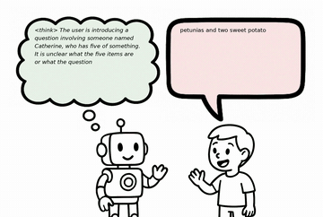

# SHANKS

SHANKS generates reasoning while the user is still talking, so reasoning costs no extra latency.

*Recording of the authors' pre-rendered demo animation (sped up 4x; the original halts every 4 s): the robot's thought bubble streams `<think>` reasoning about a math word problem while the boy's speech bubble streams his still-unfinished question. Source: [SHANKS project page](https://d223302.github.io/SHANKS/).*

| | |
|---|---|
| Year | Oct 2025 |
| Links | [arXiv 2510.06917](https://arxiv.org/abs/2510.06917) |
| Demo | [project page](https://d223302.github.io/SHANKS/): pre-rendered mp4 animations of a model thinking while the user speaks, with interruptions (math tutoring) and tool calls. Edited for reading: the caption says the video halts every 4 s. No live model and no game; human-playable: no. |
| Category | realtime architecture (thinking while speaking) |

## Details

- **Thinking while speaking** (STITCH [arXiv 2507.15375](https://arxiv.org/abs/2507.15375), SHANKS [arXiv 2510.06917](https://arxiv.org/abs/2510.06917), Mini-Omni-Reasoner [arXiv 2508.15827](https://arxiv.org/abs/2508.15827), FLAIR [arXiv 2603.17837](https://arxiv.org/abs/2603.17837)). Reasoning chunks are interleaved with spoken chunks, or generated while the user is still talking, so reasoning costs no extra latency. Speech only.

## Demo

- [video] [SHANKS project page](https://d223302.github.io/SHANKS/) — Played the hero conversation.mp4 (77.1 s) and screenshotted it and modeling_demo.mp4 (27 s) at 3 timestamps each. A cartoon robot's thought bubble streams '<think>' text (e.g. "<think> Now I have all the necessary information (...) 1. Cost") while the boy's speech bubble streams the transcript (e.g. 'three petunias'), and the model interrupts when the user's math is wrong; static figures cover math-tutoring interruption and Booking.com tool-call dialogue. Play-mode evidence (recording): static mp4s, no live model calls, no input or microphone; the caption says "We halt the video every four second to make the readers easier to see the thinking process", so the video is not in real time.

Visited 10 November 2026 in a headless browser.

Related: [STITCH](stitch.md); [Mini-Omni-Reasoner](mini-omni-reasoner.md); [FLAIR](flair.md)
