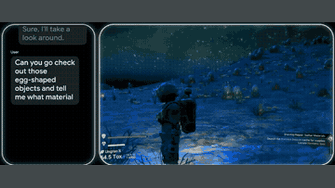

# SIMA 2

SIMA 2 fine-tunes Gemini Flash-Lite to emit text action chunks in commercial 3D games, with optional reasoning.

*Edited recording from DeepMind's SIMA 2 blog: a user asks SIMA 2 to check egg-shaped objects in No Man's Sky, and the agent replies in the chat panel and walks toward them. Source: [Google DeepMind, SIMA 2 blog](https://deepmind.google/blog/sima-2-an-agent-that-plays-reasons-and-learns-with-you-in-virtual-3d-worlds/).*

| | |
|---|---|
| Year | 2025 |
| Links | [arXiv 2512.04797](https://arxiv.org/abs/2512.04797) |
| Demo | [SIMA 2 blog](https://deepmind.google/blog/sima-2-an-agent-that-plays-reasons-and-learns-with-you-in-virtual-3d-worlds/): edited gameplay videos with chat overlays (SIMA 1 vs SIMA 2, No Man's Sky, Genie 3 worlds); limited research preview only, with no live model, replay viewer or playable demo. Human-playable: no. |
| Category | RL and decision model / post-training |
| Method | fine-tuned Gemini Flash-Lite emitting text action chunks, optional reasoning |
| Evaluated on | commercial 3D games |
| Evaluation play mode | realtime-live (follows SIMA 1 setup; not restated) |
| Basis | paper §3.2 "Periodically, the agent receives the latest frame"; same evaluation setup as SIMA 1, which "run in real-time, asynchronously to the agent" |
| What is trained (post-training table) | Gemini Flash-Lite |
| Method (post-training table) | SFT then RL from verifiable rewards |
| Evaluated on (post-training table) | 3D games |
| Evaluation play mode (post-training table) | realtime-live (follows SIMA 1 setup) |
| Basis (post-training table) | paper §3.2 and SIMA 1 §3.4.1 (see RL table) |

## Details

- **SIMA 2** fine-tunes Gemini Flash-Lite, chosen over Pro "due to the latency constraints that come with embodied action". Untrained Gemini scores 3.2% (Flash-Lite) and 7.0% (Pro) in the same harness. Action fine-tuning costs general ability (AIME -25.5% after SFT). The paper (including appendices) gives no rate and does not mention pausing; the realtime-live label follows from its statement that "Periodically, the agent receives the latest frame" and from its reuse of the SIMA 1 setup, whose environments "run in real-time, asynchronously to the agent".
- In the post-training table the Basis cell reads "paper §3.2 and SIMA 1 §3.4.1 (see RL table)"; the RL table entry is the Basis row above.

## Demo

- [video] [SIMA 2 blog post](https://deepmind.google/blog/sima-2-an-agent-that-plays-reasons-and-learns-with-you-in-virtual-3d-worlds/) — Scrolled the Nov 13, 2025 post and seeked its video carousels: side-by-side SIMA 1 vs SIMA 2 clips in MineDojo and ASKA with a chat panel (User: "Go up and slightly left to the little cave and mine to get some coal" / SIMA 2: "I've found the coal inside the cave"), a No Man's Sky clip with a chat transcript ("Sure, I'll take a look around"), and carousels on reasoning, sketch, emoji and multilingual prompts, Genie 3 worlds and self-improvement. It is a limited research preview with no public access, playable demo or replay viewer; only static video files load. Play-mode evidence (recording): no clock, tick counter or latency shown; the world keeps moving while the chat appears, but the clips are edited, so this cannot be confirmed.

Visited 10 November 2026 in a headless browser.

Related: [SIMA](sima.md); [SIMA evaluation environments](../environments/sima.md)
