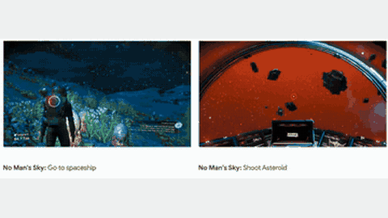

# SIMA

SIMA is a game agent for commercial 3D games whose environments "do not stop and wait while the agent computes", trained on time-offset action labels.

*Recorded gameplay of the SIMA agent carrying out two language instructions side by side in No Man's Sky, cropped from the bottom row of DeepMind's grid of example clips (no timer shown). Source: [Google DeepMind, SIMA blog post](https://deepmind.google/discover/blog/sima-generalist-ai-agent-for-3d-virtual-environments/).*

| | |
|---|---|
| Year | 2024 |
| Links | [arXiv 2404.10179](https://arxiv.org/abs/2404.10179) |
| Demo | [SIMA blog](https://deepmind.google/discover/blog/sima-generalist-ai-agent-for-3d-virtual-environments/): edited recorded gameplay clips from 9 partner games and research environments, with no latency or tick readout. No live model, replay viewer or playable demo; human-playable: no. |
| Category | RL and decision model |
| Method | 8-action chunks; trained on time-offset action labels |
| Evaluated on | commercial 3D games |
| Evaluation play mode | realtime-live |
| Basis | paper §2: environments "do not stop and wait while the agent computes its next action" |

## Details

- **SIMA** states its environments "do not stop and wait while the agent computes" and compensates by predicting actions "offset in time" during behavioural cloning. No Man's Sky: humans 60%, SIMA 34%. Not released.
- **Time-offset labels** (SIMA): train on the action that should execute one latency interval later.

## Demo

- [video] [SIMA blog post](https://deepmind.google/discover/blog/sima-generalist-ai-agent-for-3d-virtual-environments/) — Scrolled the March 2024 post and played/seeked its 2 embedded videos: a grid of short recorded gameplay clips from the 9 partner games (Valheim, Goat Simulator 3, No Man's Sky, Teardown and others) and research environments (Playhouse, Construction Lab). The text says SIMA takes screen pixels and a language instruction, outputs keyboard and mouse actions, and is evaluated on about 600 basic skills of roughly 10 s each. Play-mode evidence (recording): edited footage with no tick counter, latency readout or live controls; the page does not show whether the game was paused during inference.

Visited 10 November 2026 in a headless browser.

## What the team could reuse

- Data recipes: time-offset or delay-conditioned labels (SIMA, training-time RTC) (from the post-training reuse list).

Related: [SIMA evaluation environments](../environments/sima.md) (environment details); [SIMA 2](sima-2.md)
