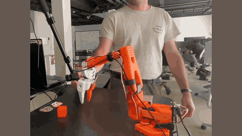

# SmolVLA async

SmolVLA's async mode refills the action queue asynchronously, decoupling action execution from policy inference.

*Recording at 1x speed of a low-cost robot arm running SmolVLA with async inference, reaching for a red cube while a person handles it; cropped from the async half of the authors' sequential-vs-async comparison video. Source: [Hugging Face, Asynchronous Robot Inference blog](https://huggingface.co/blog/async-robot-inference).*

| | |
|---|---|
| Year | Jun 2025 |
| Links | [arXiv 2506.01844](https://arxiv.org/abs/2506.01844) |
| Demo | [async inference blog](https://huggingface.co/blog/async-robot-inference) and [SmolVLA blog](https://huggingface.co/blog/smolvla): official recorded videos and GIFs of real SO-100/SO-101 arms comparing sequential and async inference with the same policy. Recordings of physical robots, not a live or playable demo. |
| Category | RL and decision model |
| Method | action queue refilled asynchronously |
| Evaluated on | robots |
| Evaluation play mode | realtime-live |
| Basis | paper §4.6: "the async mode decouples action execution and policy inference"; 9.7 s vs 13.75 s per task |

## Details

- **Asynchronous queue** (SmolVLA): refill the queue when it runs low; about 30% faster task completion with a small success drop.

## Demo

- [official video] [Asynchronous Robot Inference blog](https://huggingface.co/blog/async-robot-inference) (10 July 2025) — opened the page, played and seeked all four embedded videos. "seq_vs_async.mov" (51 s) opens on the title "Move to async" and shows an orange arm on a cube pick-and-place; caption: "Sequential inference (first) versus async inference (second) ... async inference results in (1) attempts at recovery, and (2) a ~2x speedup in task completion ... Both setups use the same policy!" "lags_videos.mp4" (9.2 s) is a community clip of the idle lag between chunks; "remi-plays-async.mp4" (14.2 s) shows the arm picking a Dynamixel box "with a tighter loop"; a fourth 44.5 s clip is also embedded. Play-mode evidence (recording): the robot keeps acting in the real world while the next chunk is computed, consistent with realtime-live; the videos are pre-recorded files, no live model calls.
- [official video] [SmolVLA blog](https://huggingface.co/blog/smolvla) — opened the page; a GIF captioned "Comparison of SmolVLA across task variations. From left to right: (1) asynchronous pick-place cube counting, (2) synchronous pick-place cube counting, ..." shows async and sync runs side by side on real arms; the text claims "30% faster response and 2× task throughput". Recording only.
- Note: the async blog reports "~2x speedup in task completion", while the file's Basis cites 9.7 s vs 13.75 s per task (about 30%); the figures come from different setups.

Visited 10 November 2026 in a headless browser.
