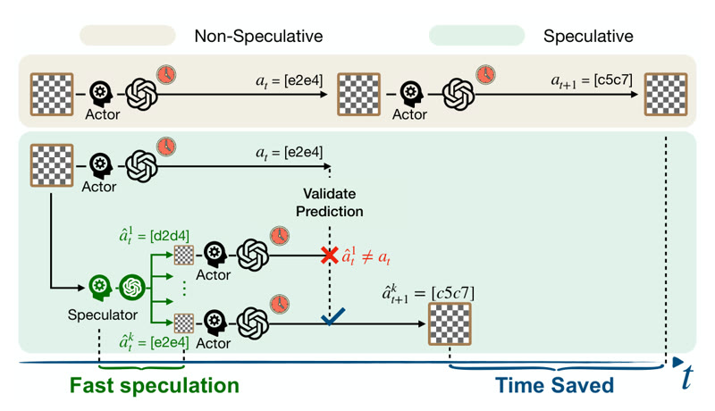

# Speculative Actions

In Speculative Actions a fast model guesses the slow actor's next step, which is pre-executed and committed on a match.

*Paper figure (diagram, Figure 1) comparing a non-speculative chess turn with one where a fast Speculator guesses candidate moves, pre-launches the Actor's next calls, and commits the matching one to save time. Source: [Speculative Actions paper, arXiv 2510.04371](https://arxiv.org/abs/2510.04371).*

| | |
|---|---|
| Year | 2025 |
| Links | [arXiv 2510.04371](https://arxiv.org/abs/2510.04371) |
| Demo | No game demo found. Only an [ICLR 2026 oral talk video](https://iclr.cc/virtual/2026/oral/10009727), hosted on SlidesLive, which is a conference talk rather than gameplay. The [code repo](https://github.com/naimengye/speculative-action) has no GIFs, videos or replay viewer, and nothing shows a model playing live. |
| Category | scaffold |
| Method | Fast model guesses the slow actor's next step; pre-execute and commit on match |
| Evaluated on | chess, tau-bench, HotpotQA, OS tuning |
| Evaluation play mode | paused-live / static |
| Results | 19.5% time saved in chess |
| Basis | paper §1: "Turn-based gameplay (e.g., chess)"; implemented on TextArena |

## Demo

- [official-video] [ICLR 2026 oral page](https://iclr.cc/virtual/2026/oral/10009727) — Rendered the page. It has a "Video" panel that embeds SlidesLive presentation 39062061 for the talk "Speculative Actions: A Lossless Framework for Faster AI Agents" (Oral Session 3A Agents, Fri, Apr 24, 2026). In headless Chrome the embed showed "It appears you are a search engine bot." and did not play, so I could not watch any frames. This is a conference talk, not gameplay, replay or a playable demo. Play-mode evidence: none.
- [none] [Code repo](https://github.com/naimengye/speculative-action) — It has no homepage field. The README and the whole file tree contain no GIFs, videos or replay viewer, only three tau-bench figure PNGs. The chess-game code takes saved trajectories as input, but nothing renders them for viewing.

Searched 10 November 2026; no game demo found (only the talk video above, which would not play in a headless browser).
