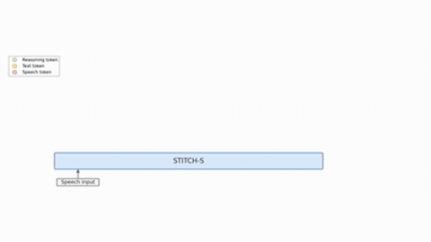

# STITCH

STITCH interleaves reasoning chunks with spoken chunks so reasoning costs no extra latency.

*The authors' illustrative animation (not a recording of a live run, sped up 2x) of STITCH-S taking speech input and emitting chunks of reasoning (green), text (yellow) and speech (red) tokens while the audio output streams above. Source: [STITCH project page](https://d223302.github.io/STITCH/).*

| | |
|---|---|
| Year | 2025-26 |
| Links | [STITCH](https://arxiv.org/abs/2507.15375) |
| Demo | [project page](https://d223302.github.io/STITCH/): pre-rendered mp4 animations of chunked unspoken reasoning interleaved with speech tokens on spoken math QA. Scripted and illustrative (the page notes the 'speed shown here is an ideal case'). No live model and no game; human-playable: no. |
| Category | realtime architecture (thinking while speaking) / post-training |
| Method | interleaved or latent reasoning |
| Evaluated on | spoken QA |
| Evaluation play mode | realtime-live (speech) |
| Basis | papers: STITCH §4 |
| What is trained | speech LLMs |

## Details

- **Thinking while speaking** (STITCH [arXiv 2507.15375](https://arxiv.org/abs/2507.15375), SHANKS [arXiv 2510.06917](https://arxiv.org/abs/2510.06917), Mini-Omni-Reasoner [arXiv 2508.15827](https://arxiv.org/abs/2508.15827), FLAIR [arXiv 2603.17837](https://arxiv.org/abs/2603.17837)). Reasoning chunks are interleaved with spoken chunks, or generated while the user is still talking, so reasoning costs no extra latency. STITCH reports +15% on spoken math at the latency of a no-reasoning baseline. Speech only.

## Demo

- [video] [STITCH project page](https://d223302.github.io/STITCH/) — Played the autoplaying hero video (from #t=13) and screenshotted stitch_r_token_demo.mp4 (47.7 s) and stitch_s.mp4 (25.5 s) at about 15%, 50% and 90%. The animations (hero STITCH-R timeline, no_reason.mp4, tbs.mp4, stitch_r.mp4, stitch_s.mp4, two 'real token example' videos) show a GSM8K-style question ('Josh decides to try flipping a house...') with the inner monologue interleaved with [SOPR]/[EOPR] markers, spoken text and <audio_xxxx> speech tokens. Play-mode evidence (recording): static mp4s from /static/videos/ with no model or API calls; the page says "Note that the speed shown here is an ideal case, and the real speed depends on the hardware and implementation." The timing argument (2 s audio chunk = 26 speech + 13 text tokens; about 160 tokens per 2 s on an A100 with vLLM) appears only as text, with no live latency counter.
- Note: the file labels evaluation play mode as realtime-live (speech), but the demo videos are scripted animations at an "ideal case" speed, not recordings of a live timed run.

Visited 10 November 2026 in a headless browser.

Related: [SHANKS](shanks.md); [Mini-Omni-Reasoner](mini-omni-reasoner.md); [FLAIR](flair.md)
