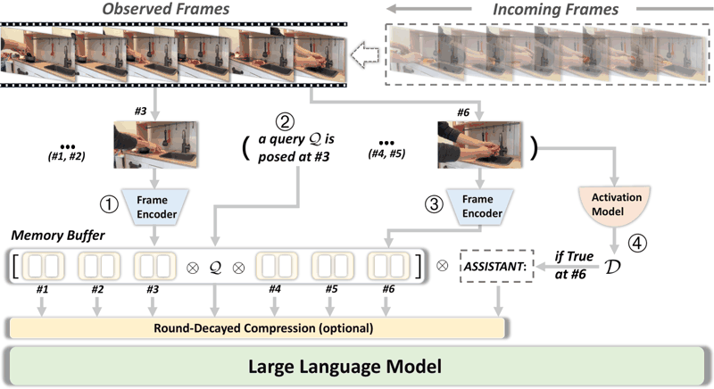

# StreamBridge

StreamBridge is a streaming video LLM.

*Diagram (paper Figure 2): incoming frames are encoded into a memory buffer interleaved with a query, optionally compressed, and a separate activation model decides at each frame (here #6) whether the LLM should respond. Source: [Wang et al., StreamBridge, arXiv 2505.05467](https://arxiv.org/html/2505.05467v2).*

| | |
|---|---|
| Category | realtime architecture (streaming video LLM) |
| Demo | None found (searched: GitHub repo apple/ml-streambridge README and assets (no homepage set; `demo.py` is a local script and weights are not released), arXiv 2505.05467 abstract comments, Apple ML Research page, web search for "StreamBridge demo" / project page / video) |

## Details

- **Streaming video LLMs** (VideoLLM-online, Flash-VStream, Dispider, StreamBridge, LiveCC, StreamingVLM, OmniMMI/M4, Proact-VL). The only "action" is when to speak. Evaluations replay recorded video and mostly score offline.

## Demo

- None found. The [GitHub repo](https://github.com/apple/ml-streambridge) has no homepage. Its "Demo for Quick Start" section is a local `python demo.py` script whose checkpoints are listed as "TBD due to video copyright reasons", and the repo assets hold only figures and benchmark JSON files. The [Apple ML Research page](https://machinelearning.apple.com/research/proactive-streaming-assistant), rendered in the browser, shows only the abstract and a "View publication" link, with no video. The arXiv comments say only "Accepted by NeurIPS 2025".

Searched 10 November 2026; no demo found.

Related: [VideoLLM-online](videollm-online.md); [Dispider](dispider.md)
