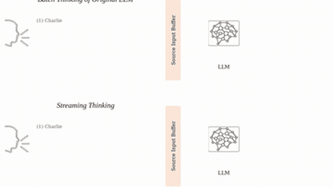

# StreamingThinker

StreamingThinker reasons while the prompt streams, with separate position IDs and parallel KV caches.

*The authors' schematic animation (not a model run), sped up 3x: batch thinking waits for the whole word problem before prefill and thinking, while streaming thinking prefills and thinks after each arriving sentence. Source: [StreamingThinker project page](https://jl-tong.github.io/streamingthinker).*

| | |
|---|---|
| Year | Oct 2025 |
| Links | [arXiv 2510.17238](https://arxiv.org/abs/2510.17238) |
| Demo | [project page](https://jl-tong.github.io/streamingthinker) with an animated GIF (also in the [repo README](https://github.com/EIT-NLP/StreamingLLM/tree/main/StreamingThinker)): a schematic of batch thinking next to streaming thinking on one math word problem. It is an illustration, not a live model, recording of a run, replay viewer or anything a human can play; no game. |
| Category | realtime architecture / post-training |
| Method | Reasons while the prompt streams; parallel KV caches |
| Evaluation play mode | static (simulated streaming input) |
| Open source | Open, Qwen3 fine-tune |
| Basis | paper §4.1 latency definition with simulated input speed |
| Channels (in / out) | streaming text / text |
| Tick | per sentence |
| What is trained (post-training table) | Qwen3 |
| Method (post-training table) | streaming CoT data, masks, parallel caches |
| Evaluated on (post-training table) | QA |
| Evaluation play mode (post-training table) | static |
| Basis (post-training table) | paper §4.1 simulated input speed |

## Details

- **Streaming and duplex text models.** Duplex models (time slices of text), StreamingThinker (think while reading, with separate position IDs and parallel KV caches), Asynchronous Reasoning (training-free concurrent thinking and writing). These are the nearest text-only mechanisms for new input landing mid-thought. All are evaluated on static QA or chat.

## Demo

- [project-page] [StreamingThinker project page](https://jl-tong.github.io/streamingthinker): I rendered the page and dumped its text and media. It has no video, iframe or canvas, only images: `combined.gif`, method figures (`CoT.png`, `Train.png`, `Inference.png`) and screenshots of three result tables. I pulled the GIF apart (92 frames, about 15.9 s per loop). The caption reads "Demo: batch thinking of original LLM waits for the full input, while streaming thinking unfolds alongside arriving context." In the top panel, "Batch Thinking of Original LLM", sentences (1) to (4) of the Charlie two-day conference problem pass through Read into a "Source Input Buffer". Prefill and Think start only after (4) has arrived. In the bottom panel, "Streaming Thinking", each sentence ends in <EOS> and gets its own Prefill and Think step as it arrives (for example "Okay, now we get the background of Charlie's schedule.<EOT>"). Both panels end with "The answer is 5.25 hours." Play-mode evidence: it is a hand-made schematic animation with fixed text. No model is called and the page makes no network calls beyond static images. It has no clock, timestamps or game. The same GIF is in the repo README at `assets/combined.gif`. The README's Hugging Face "Demo" badge is commented out; only a dataset badge (StreamingCoT) is shown.

Visited 10 November 2026 in a headless browser.

Related: [Duplex models / MiniCPM-Duplex](duplex-models.md); [Asynchronous Reasoning](asynchronous-reasoning.md)
