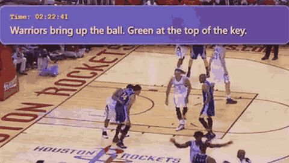

# StreamingVLM

StreamingVLM is a streaming video LLM.

*Recording from the authors' README demo video (cropped, real time) of StreamingVLM writing play-by-play commentary captions, with a video timestamp, as a Warriors vs Rockets broadcast plays. Source: [mit-han-lab/streaming-vlm README](https://github.com/mit-han-lab/streaming-vlm).*

| | |
|---|---|
| Category | realtime architecture (streaming video LLM) |
| Demo | [Demo page](https://streamingvlm.hanlab.ai) (Cloudflare 502 in Nov 2026) and a [README demo video](https://github.com/mit-han-lab/streaming-vlm): a 2 min 26 s recording of the model writing live sports commentary captions over basketball and American football footage. Recorded output on video, not game play; not human-playable. |

## Details

- **Streaming video LLMs** (VideoLLM-online, Flash-VStream, Dispider, StreamBridge, LiveCC, StreamingVLM, OmniMMI/M4, Proact-VL). The only "action" is when to speak. Evaluations replay recorded video and mostly score offline.

## Demo

- [project page] [streamingvlm.hanlab.ai](https://streamingvlm.hanlab.ai) — Linked from the README as "Demo Page" ("see more cases and try our model"); opened it twice in headless Chrome and both times got "hanlab.ai | 502: Bad gateway" from Cloudflare. Play-mode evidence: none observable.
- [video] [README demo video](https://github.com/mit-han-lab/streaming-vlm) — Played the embedded GitHub user-attachments MP4 (1a15b496-...d864.mp4, 146.5 s) and seeked to 5 s, 60 s and the end. It is a screen recording of commentary captions overlaid in a purple box on sports broadcasts, for example "Dribbles right. Passes to Livingston." over a Warriors vs Rockets NBA clip (scoreboard "4TH 2:16"), then an NFL Browns vs Jets clip. Play-mode evidence (recording): captions are emitted as the video plays, showing streaming commentary; there is no game agent, action, or latency readout.

Visited 10 November 2026 in a headless browser.

Related: [VideoLLM-online](videollm-online.md); [Dispider](dispider.md)
