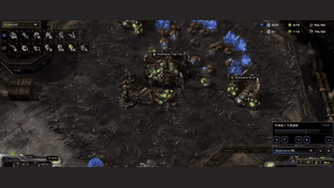

# SwarmBrain

SwarmBrain combines an LLM strategy with a reflex state machine for StarCraft II against the built-in AI.

*Recording of a SwarmBrain (Zerg) game against the built-in Terran AI, played back in the StarCraft II replay viewer at "Faster" speed around 7:45 of 13:23, with the video's own cut between the Zerg base and the Terran army. Source: [authors' demo video on YouTube](https://www.youtube.com/watch?v=-F0PQJPI4HM).*

| | |
|---|---|
| Year | Jan 2024 |
| Links | [arXiv 2401.17749](https://arxiv.org/abs/2401.17749) |
| Demo | Official demo video ([YouTube](https://www.youtube.com/watch?v=-F0PQJPI4HM), [Bilibili](https://www.bilibili.com/video/BV1jZ421a7b7/)) linked from the [GitHub README](https://github.com/ramsayxiaoshao/SwarmBrain), plus one replay file (`videos/ZvT_Medium.SC2Replay`) in the repo. The video is a recording of a 13:23 Zerg-vs-Terran game played back in the StarCraft II replay viewer at "Faster" speed. It is not live and not human-playable. |
| Category | scaffold |
| Method | LLM strategy + reflex state machine |
| Evaluated on | StarCraft II vs built-in AI |
| Evaluation play mode | realtime-live |
| Results | 76% against Hard |
| Basis | code: `swarmbrain_launch.py:2666-2671` `run_game(..., realtime=True)`; LLM via `run_in_executor` (`swarmbrain.py:79`) |

## Demo

- [video] [YouTube: "Can Large Language Model (LLM) play StarCraft II? SwarmBrain conquers the Battlefield."](https://www.youtube.com/watch?v=-F0PQJPI4HM). I played the 7:51 (471 s) video and sought to 5%, 25%, 50%, 75% and 95%. Playback stalled while buffering in headless Chrome, so every frame I captured showed the same moment: the StarCraft II replay viewer at "1:13 / 13:23", speed "Faster", with a Terran main base in view. The description reads "Paper from BMW AI Team". Play-mode evidence: this is a recording of a replay, and no LLM latency or command overlay is visible.
- [video] [Bilibili: "AI plays StarCraft but with a Large Language Model LLM"](https://www.bilibili.com/video/BV1jZ421a7b7/), uploaded 2024-03-05, 07:52 long. I played it and sought to 10%, 50% and 90%. Without a login it is limited to a "30-second preview", but the seeked frames still rendered. They show replay-viewer timestamps "1:57 / 13:23", "6:36 / 13:23" and "10:02 / 13:23", with Zerg supply growing from 21/31 to 43/63 to 43/86 and a large late-game fight. The description says the Overmind matrix "uses GPT3.5 as the LLM core and can generate about 30 commands in roughly 12 seconds". It also says "commands have already been generated through the LLM before the game starts" to cover the first inference, and that SwarmBrain "only needs normal game time to defeat the Harder computer without needing to stall the process". Play-mode evidence: a recording of a replay. The description claims real-time play with no pausing, but the video itself does not show this.
- [replay] [GitHub repo `videos/ZvT_Medium.SC2Replay`](https://github.com/ramsayxiaoshao/SwarmBrain/tree/main/videos) (27,260 bytes). I listed it through the GitHub API but did not open it, because it needs the StarCraft II client. The README also gives a `run_game(..., realtime=True, save_replay_as="./videos/ZvT_Human.SC2Replay")` snippet for playing against SwarmBrain yourself locally. Play-mode evidence: none observable in the browser.

Visited 10 November 2026 in a headless browser.

Related: [PySC2 / python-sc2](../environments/pysc2-python-sc2.md) (python-sc2 `realtime=True`)
