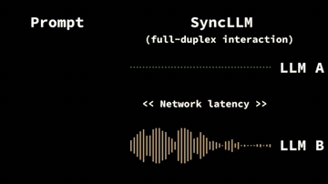

# SyncLLM

SyncLLM predicts the user's next speech chunk to hide latency.

*5 s clip (30-35 s) from the authors' explainer video: two SyncLLM instances (LLM A, LLM B) take turns speaking in full-duplex across a simulated network latency, shown as animated waveforms. Source: [SyncLLM project page](https://syncllm.cs.washington.edu/).*

| | |
|---|---|
| Year | Sep 2024 |
| Links | [arXiv 2409.15594](https://arxiv.org/abs/2409.15594) |
| Demo | [project page](https://syncllm.cs.washington.edu/): static page that only plays pre-recorded media: a 63 s explainer video and 8 Fisher/Candor dialogue prompts with 60 s continuations from SyncLLM-F, dGSLM and SyncLLM-F-C (two SyncLLMs talking under a simulated 160 ms latency). No live model and no game; human-playable: no. |
| Category | realtime architecture |
| Method | Predicts the user's next chunk to hide latency |
| Evaluation play mode | static (continuation) + realtime-live (speech, simulated one-chunk latency) |
| Open source | Llama-3-8B fine-tune |
| Basis | paper §5.4 "We simulate LLM-user interaction using LLM-LLM interaction with one-chunk latency" |
| Channels (in / out) | two speech streams |
| Tick | 160-240 ms chunks |

## Demo

- [project-page] [SyncLLM project page](https://syncllm.cs.washington.edu/) — Played the 63 s narrated overview video (SyncLLM.mp4) at 2/15/30/45/60 s and listed the 40 audio files. The video shows waveform animations with 'SyncLLM (full-duplex interaction)', LLM A and LLM B and a '<< Network latency >>' label; the table has 8 prompts (Fisher, Candor), each with 5 static .wav files: 30 s prompt, 60 s ground truth, and 60 s continuations from SyncLLM-F, dGSLM and SyncLLM-F-C (two SyncLLMs talking with a simulated 160 ms latency). Play-mode evidence: all pre-generated; network requests are only /SyncLLM.mp4 and /audio/<dialogue_id>/*.wav with no websocket or API calls, and the latency (160 ms, up to 240 ms) is simulated, not measured live.

Visited 10 November 2026 in a headless browser.