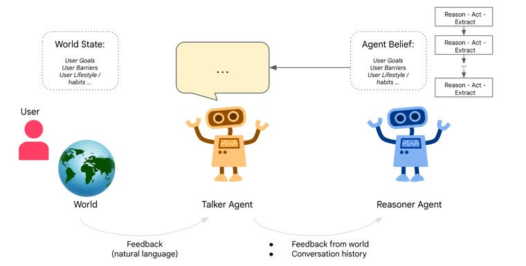

# Talker-Reasoner

Talker-Reasoner pairs a fast talker with a slow reasoner sharing memory.

*Diagram (paper Figure 1): the fast Talker agent converses with the user and world, while the slow Reasoner agent runs multi-step reason-act-extract loops and writes agent beliefs (user goals, barriers, habits) that the Talker reads. Source: [Christakopoulou et al., arXiv 2410.08328](https://arxiv.org/abs/2410.08328).*

| | |
|---|---|
| Year | Oct 2024 |
| Links | [arXiv 2410.08328](https://arxiv.org/abs/2410.08328) |
| Demo | None found (searched: arXiv abstract page and comments, NeurIPS 2024 OWA workshop poster page, OpenReview, web search for "Talker-Reasoner" demo, video and GitHub; no official code, project page or video) |
| Category | scaffold |
| Method | Fast talker + slow reasoner with shared memory |
| Evaluated on | sleep-coaching example |
| Evaluation play mode | none |
| Results | no quantitative evaluation |
| Basis | paper §4: case study with "Qualitative Results" only |

## Demo

- None found. The arXiv abstract page has no comments and links no code, project page or video. The NeurIPS 2024 OWA workshop poster page (https://neurips.cc/virtual/2024/100894) links only to OpenReview, with no video or slides. A web search for "Talker-Reasoner" with demo, video and GitHub turned up only press coverage and third-party write-ups, such as a LiveKit blog post on the pattern, and nothing official.

Searched 10 November 2026; no demo found.
