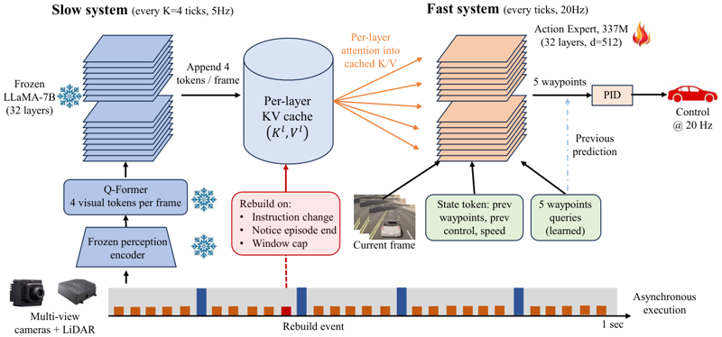

# Think at 5 Hz, Act at 20 Hz

"Think at 5 Hz, Act at 20 Hz" trains a fast action head that reads a stale VLM cache with randomised staleness.

*Method diagram (paper Figure 2): a frozen LLaMA-7B backbone appends tokens to a per-layer KV cache every 4 ticks (5 Hz), while a 337M action expert cross-attends into that cache at every tick (20 Hz) to output waypoints for a PID controller. Source: [arXiv 2607.15621, Figure 2](https://arxiv.org/html/2607.15621).*

| | |
|---|---|
| Year | 2026 |
| Links | [arXiv 2607.15621](https://arxiv.org/abs/2607.15621) |
| Demo | None found (searched: arXiv abstract page and comments, arXiv HTML paper links, Hugging Face paper page and linked Spaces/models, GitHub repo search, web search for project page, demo or video) |
| Category | post-training / scaffold (robotics dual system) |
| Method | randomised cache staleness |
| Evaluated on | CARLA |
| Evaluation play mode | paused-live (CARLA synchronous mode) |
| Basis | paper §4.4: "in CARLA's synchronous mode the vehicle still receives fresh control at every tick" |
| What is trained | action expert on frozen VLM |

## Details

- Robotics dual systems (brief). "Think at 5 Hz, Act at 20 Hz" ([arXiv 2607.15621](https://arxiv.org/abs/2607.15621)): a fast head reads a stale VLM cache and is trained with randomised staleness; CARLA route completion 37% to 94%.

## Demo

- None found. The arXiv abstract page (comments: "13 pages, 5 figures, 4 tables") and the HTML paper give no project page, code or video link; the Hugging Face paper page lists no GitHub repo or project page and has no linked Spaces or models; GitHub repo search and a web search for a project page, demo or video turned up nothing.

Searched 10 November 2026; no demo found.

## What the team could reuse

- Data recipes: randomised staleness (from the post-training reuse list).

Related: [CARLA](../environments/carla.md); [Hi Robot](hi-robot.md); [Figure Helix](figure-helix.md); [FiS-VLA](fis-vla.md)
