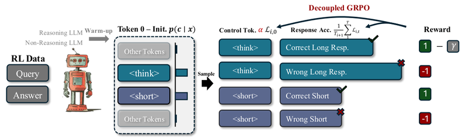

# Thinkless

Thinkless trains a reasoning LLM with RL to choose between thinking and not thinking.

*Method diagram (paper Figure 2): after warm-up, the model samples a control token, think or short, then a response, and Decoupled GRPO rewards correct short answers more than correct long ones and penalises wrong ones. Source: [Thinkless paper, Fang et al. 2025](https://arxiv.org/abs/2505.13379).*

| | |
|---|---|
| Year | 2025 |
| Links | [Thinkless](https://arxiv.org/abs/2505.13379) |
| Demo | None found (searched: arXiv abstract page and comments, GitHub repo VainF/Thinkless README and homepage field, Hugging Face model cards and Spaces). |
| Category | post-training |
| Method | RL to choose think or no-think |
| Evaluated on | math |
| Evaluation play mode | static |
| Basis | Thinkless §4.1 (math) |
| What is trained | reasoning LLM |

## Demo

- None found. The [GitHub repo](https://github.com/VainF/Thinkless) has no homepage set, and its README links only the paper, code, Hugging Face model checkpoints (Thinkless-1.5B-RL-DeepScaleR, Thinkless-1.5B-Warmup) and datasets, plus a pipeline figure. No project page or video. The arXiv abstract gives only the code link. The models list no Hugging Face Spaces. The one Space search hit, Kankshi/thinkless, is a third-party Docker Space and not by the authors. The work is evaluated on static math benchmarks, so it has no game demo.

Searched 10 November 2026; no demo found.

Related: [AdaptThink](adaptthink.md)
