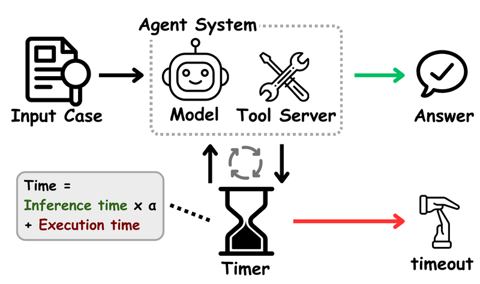

# Timely-RL

Timely-RL trains an 8B LLM with a timer tool using SFT and GRPO, with zero reward if the answer is over the wall-clock budget.

*A diagram from the paper: a timer adds up scaled inference time and tool execution time while the model works, and the episode either returns an answer or times out. Source: [Figure 1 from Ma et al., "Timely-RL" (arXiv 2601.16486)](https://arxiv.org/abs/2601.16486).*

| | |
|---|---|
| Year | 2026 |
| Authors / org | Ma et al. |
| Links | [arXiv 2601.16486](https://arxiv.org/abs/2601.16486) |
| Demo | None found (searched: arXiv abstract page and comments, paper HTML links, GitHub repo [Entarochuan/Timely-Machine](https://github.com/Entarochuan/Timely-Machine) README, assets and homepage field, ACL Anthology, web search for Timely Machine / TimelyLM demo, Hugging Face). |
| Category | post-training |
| Method | SFT + GRPO; zero reward if over the wall-clock budget |
| Evaluated on | math, GPQA, Jericho text games |
| Evaluation play mode | static with deadline |
| Basis | paper §4.1: Jericho with assigned interaction delays; §5.2.2 over-budget answers count as incorrect |
| What is trained | 8B LLM with timer tool |

## Details

- **Timely-RL** (Ma et al.). Reward is zero if over time; if correct and on time, accuracy plus a bonus for using the budget. Generation time is rescaled during RL to imitate faster or slower hardware. TimelyLM-8B against Qwen3-8B: on-time rate at 0.75x budget on AIME 53.3% against 30.0%. The closest existing reward design, but the world does not change while the model thinks.

## Demo

- None found. The arXiv abstract lists no project page (comments: "Under Review"). The official repo [Entarochuan/Timely-Machine](https://github.com/Entarochuan/Timely-Machine) ("[ACL 2026 Oral]") has an empty homepage field. Its README has only static figures (`RL_pipeline (1).png`, `interactive_games_time_performance.png`) and no videos, GIFs, replays or hosted demo. Web searches for a Timely Machine or TimelyLM demo, a Hugging Face Space or a video found nothing.

Searched 10 November 2026; no demo found.

## What the team could reuse

- Reward shaping: Timely-RL's deadline reward (from the post-training reuse list).

Related: [Jericho](../environments/jericho.md) (evaluated on)
