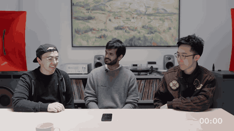

# TML-Interaction-Small (Thinking Machines Lab interaction models)

TML-Interaction-Small is a 276B-parameter MoE interaction model whose input and output are interleaved in 200 ms micro-turns, with a separate asynchronous background model that reasons and calls tools.

*Animation (Figure 1, "Time-aligned micro-turn based") from the authors' blog post, captured from the page: video frames, the user's audio and the model's audio fill in side by side in 200 ms micro-turns over about 3 s, so the model speaks while the user is still talking; hovering the markers then labels four moments: "Model interrupts and responds immediately" (micro-turn 3, 600 ms), "Model and user both remain silent" (1400 ms), "Model backchannels while the user talks" (2000 ms) and "Model reacts to visual clues without explicit prompting" (2600 ms). Source: [Thinking Machines Lab, "Interaction models" blog, Figure 1 (May 2026)](https://thinkingmachines.ai/blog/interaction-models/).*

| | |
|---|---|
| Year | May 2026 |
| Authors / org | Thinking Machines Lab |
| Links | [blog](https://thinkingmachines.ai/blog/interaction-models/) |
| Demo | [blog](https://thinkingmachines.ai/blog/interaction-models/) and [YouTube](https://www.youtube.com/@thinkymachines): 10 pre-recorded company demo videos of live full-duplex voice/video conversation (interjections, live translation, time awareness, rep counting, tool calls), an animated 200 ms micro-turn diagram, and a page widget comparing recorded audio from TML vs GPT-realtime/Gemini. No games, no try-it access; human-playable: no. |
| Category | realtime architecture |
| Method | Separate asynchronous background model reasons and calls tools |
| Evaluation play mode | realtime-live (speech); no game or control evaluation |
| Results | Self-reported: Full-Duplex-Bench v1 turn-taking latency 0.40 s; v1.5 average 77.8; TimeSpeak 64.7, CueSpeak 81.7, RepCount-A 35.4, Charades start/stop 32.4 mIoU |
| Open source | No weights or public API as of the May 2026 post |
| Basis | docs: blog (saved) "continuous input and output streams split into micro-turns" of 200 ms; benchmarks self-reported |
| Channels (in / out) | text, audio, video / text, audio |
| Tick | 200 ms micro-turns |

## Details

- **Thinking Machines Lab interaction models** (blog, 11 May 2026). TML-Interaction-Small is a 276B-parameter MoE with 12B active, encoder-free. Input and output are interleaved in 200 ms micro-turns in one sequence, so silence, overlap and elapsed time are in context. Long reasoning is pushed to a background model that shares the conversation and whose results are woven back in. Self-reported: Full-Duplex-Bench v1 turn-taking latency 0.40 s (GPT-realtime-2.0 minimal 1.18 s; Gemini-3.1-flash-live 0.57 s); v1.5 average 77.8 against 46.8. Timing benchmarks, against GPT-realtime-2.0 minimal: TimeSpeak 64.7 / 4.3, CueSpeak 81.7 / 2.9, RepCount-A 35.4 / 1.3, Charades start/stop 32.4 / 0 mIoU. No game or action experiment.

## Demo

- [video] [Interaction models blog](https://thinkingmachines.ai/blog/interaction-models/) — Scrolled the full blog, clicked three of the 10 YouTube click-to-load posters, seeked the local example-5 video.mp4 (37 s) to 10/50/90%, and viewed the animated Figure 1 and the Example 1-5 audio comparison widget. The 10 company-made office videos cover intro, dialog management, visual and verbal interjection, simultaneous speech (live translation), time awareness, simultaneous tool calls/search, generative UI, 'Diet manager' and 'in-ear' collaboration, with captions such as 'Model instantly reacts to visual cues'. Figure 1 compares turn-based I/O with 200 ms 'time-aligned micro-turns' (1000 ms axis); the widget pairs recorded inputs with pre-recorded output wavs from TML-interaction-small, Gemini-high, Gemini-minimal, GPT-realtime-2 and GPT-realtime-2-xhigh (example 5: a person holds up fingers). Bar charts cover TimeSpeak, CueSpeak, RepCount-A, ProactiveVideoQA and Charades, plus FD-bench (turn-taking latency 0.40 s vs 1.18 s for GPT-realtime-2). Play-mode evidence (recording): static media only (YouTube embeds, /audio/interaction-models/example-N/*.wav, video.mp4), no model API or WebSocket calls; the videos show the model talking while the user talks or moves with no turn-taking pause, but they are edited with no on-screen latency or clock. No game and no public try-it access.
- [video] [Diet manager video](https://www.youtube.com/watch?v=qXdYDUqxSxA) — Opened the 60 s YouTube video and took a frame at 40%: a person drinks a can while the model comments, caption 'Model instantly reacts to visual cues'. The description says the model "parses video, looks up information, and handles interruptions in real time ... This is a preview demo of our interaction model." Edited company video with no latency figures or clock; no game.

Visited 10 November 2026 in a headless browser.

## What the team could reuse

- Reuse: the micro-turn serialisation can be imitated in text post-training without a new architecture; the timing tasks are tiny, verifiable, human-easy realtime tasks.
- Serialisation ideas for post-training a text model: micro-turns (from the architectures reuse list).

Related: [Thinking Machines TimeSpeak / CueSpeak](../environments/thinking-machines-timespeak-cuespeak.md); [Full-Duplex-Bench](../environments/full-duplex-bench.md); [gpt-realtime-2](gpt-realtime-2.md); [Gemini Live](gemini-live.md)
