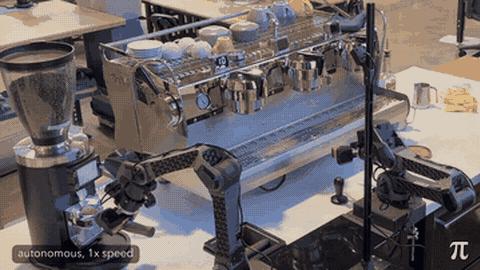

# Training-time RTC

Training-time RTC simulates the inference delay in training by giving the committed prefix as clean input.

*Recording (1x speed, autonomous) of the π\*0.6 espresso demo, which Physical Intelligence says used training-time RTC: the robot takes the portafilter from the grinder and moves it toward the machine. Source: [Physical Intelligence, π\*0.6 blog](https://www.pi.website/blog/pistar06).*

| | |
|---|---|
| Year | Dec 2025 |
| Links | [arXiv 2512.05964](https://arxiv.org/abs/2512.05964) |
| Demo | [π\*0.6 blog](https://www.pi.website/blog/pistar06) (official videos) and the update note on the [RTC research page](https://www.pi.website/research/real_time_chunking): recorded real-robot videos of the π\*0.6 espresso-making demo, which the RTC page says used training-time RTC. These are recordings of the robot running, not a live demo, replay viewer or anything a human can play. |
| Category | post-training |
| Method | delay simulated in training |
| Evaluated on | robots |
| Evaluation play mode | realtime-live |
| Basis | paper §3: inference delay in controller timesteps; §4 Kinetix and real robots |
| What is trained | flow VLA |

## Details

- **Training-time RTC** ([arXiv 2512.05964](https://arxiv.org/abs/2512.05964)): simulate the delay in training by giving the committed prefix as clean input.

## Demo

- [official-video] [Physical Intelligence RTC research page](https://www.pi.website/research/real_time_chunking): I rendered the page and played its video. The page has a "Follow-Up Paper" button linking to arXiv 2512.05964 and a banner: "Update (Dec 8th, 2025): we released a follow-up paper describing a training-time version of RTC, which we used in the π\*0.6 espresso-making demo!" The page's own video (`sizzle.mp4`, 2:17, 137.6 s) and its replays show the earlier inference-time RTC paper, not this one. Play-mode evidence: the robots run against the physical clock in real time; the page has no replays or interactive parts specific to training-time RTC.
- [official-video] [π\*0.6 blog, "π\*0.6: a VLA that Learns from Experience"](https://www.pi.website/blog/pistar06) (linked from the banner as "espresso-making demo"): I rendered the page (35 video elements, including `PiFinal.mp4` at 3:50, `making_coffee.mp4` at 106.8 s, `coffee.mp4` and `box_building.mp4`), then seeked `making_coffee.mp4` and took screenshots. The frame at 60 s shows a bimanual robot handling a portafilter and glass at an espresso machine. The caption says the model can "make various espresso drinks from 5:30am to 11:30pm ... all shown here without interruption". Play-mode evidence (recording): continuous real-robot footage consistent with realtime-live control. The blog never names training-time RTC itself; that link comes only from the RTC page banner. It is not human-playable and has no replay viewer.

Visited 10 November 2026 in a headless browser.

## What the team could reuse

- Data recipes: time-offset or delay-conditioned labels (SIMA, training-time RTC) (from the post-training reuse list).

Related: [Real-Time Chunking](real-time-chunking.md); [Real-Time Chunking Kinetix benchmark](../environments/real-time-chunking-kinetix.md)
