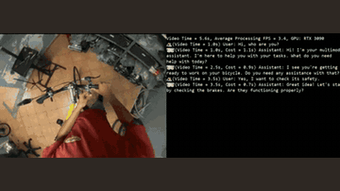

# VideoLLM-online

VideoLLM-online decides per video frame whether to stay silent or speak.

*Recording from the authors' teaser video (5 s clip, title banner cropped): egocentric bike-repair video on the left, the live CLI transcript on the right with a running video clock, average processing FPS on an RTX 3090 and per-reply cost. Source: [VideoLLM-online project page](https://showlab.github.io/videollm-online).*

| | |
|---|---|
| Year | Jun 2024 |
| Links | [arXiv 2406.11816](https://arxiv.org/abs/2406.11816) |
| Demo | [project page](https://showlab.github.io/videollm-online): recorded screen capture of a live streaming video-LLM run on egocentric video (bike repair, cooking), not a game. The model comments proactively, with a video-time clock, processing FPS (about 3 to 12 on an RTX 3090) and a latency per reply shown on screen. [HF Space](https://huggingface.co/spaces/chenjoya/videollm-online) is down (runtime error, deprecated). Human-playable: no. |
| Category | realtime architecture |
| Method | Decides per frame to stay silent or speak |
| Evaluation play mode | offline replay |
| Open source | Open |
| Basis | paper §4: Ego4D "timestamp-narration" streaming set |
| Channels (in / out) | video frames / text |
| Tick | per frame |

## Details

- **Streaming video LLMs** (VideoLLM-online, Flash-VStream, Dispider, StreamBridge, LiveCC, StreamingVLM, OmniMMI/M4, Proact-VL). The only "action" is when to speak. Evaluations replay recorded video and mostly score offline.

## Demo

- [video] [VideoLLM-online project page](https://showlab.github.io/videollm-online) — Played the muted teaser.mp4 (72.5 s) and screenshotted it at 10%, 40% and 75%. It is a screen recording of the CLI demo: egocentric video (bicycle repair, then cooking) on the left and a terminal transcript of user turns and proactive assistant turns on the right, e.g. 'Video Time = 13.1s, Average Processing FPS = 3.8, GPU: RTX 3090' and '(Video Time = 3.5s, Cost = 0.4s) Assistant: You stir the food in pot.' Play-mode evidence (recording of a live streaming run): a running video clock, processing FPS of 3.1 to 11.6 on an RTX 3090 and per-reply cost of 0.3 to 1.5 s; the caption says "Pauses in the video is for waiting the slow audio. The inference speed of the model can approach real-time (5~10 FPS on RTX 3090, 10~15 FPS on A100)." The model only perceives and comments; no game or actions.
- [dead-or-unreachable] [HF Space](https://huggingface.co/spaces/chenjoya/videollm-online) — Shows 'Runtime error: Workload evicted, storage limit exceeded (50G)'; the GitHub README marks the Space deprecated as too slow and recommends running demo/cli.py locally.
- Note: the file labels evaluation play mode as offline replay, but the demo video records a live streaming-inference run in which the video clock keeps running while the model processes (edited to pause for TTS audio).

Visited 10 November 2026 in a headless browser.