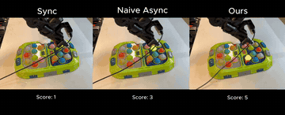

# VLASH

VLASH conditions the policy on the predicted state at execution time.

*Recording of three real robot arms playing whack-a-mole side by side, the Sync, Naive Async and VLASH (Ours) policies, with running scores; Naive Async fails after too many wrong presses while VLASH keeps scoring (autonomous, sped up 4x from the 1x original). Source: [VLASH demo video, MIT Han Lab](https://www.youtube.com/watch?v=IgN7CNicJS8).*

| | |
|---|---|
| Year | Dec 2025 |
| Links | [arXiv 2512.01031](https://arxiv.org/abs/2512.01031) |
| Demo | [Project page](https://hanlab.mit.edu/projects/vlash) with an embedded [YouTube demo video](https://www.youtube.com/watch?v=IgN7CNicJS8) (also in the [repo README](https://github.com/mit-han-lab/vlash)): a 4 min recording of real robot arms running the VLA autonomously at 1x speed, playing ping-pong and whack-a-mole, with a Sync / Naive Async / Ours comparison. Recording only; no live, replay or human-playable demo. |
| Category | RL and decision model |
| Method | condition on predicted state at execution time |
| Evaluated on | robots |
| Evaluation play mode | realtime-live |
| Basis | paper §V-A1 "simulated delays ranging from 0 to 4 steps"; §V-B real robots |

## Details

- **VLASH**: condition on the predicted future state.

## Demo

- [project page] [VLASH project page (MIT Han Lab)](https://hanlab.mit.edu/projects/vlash) — Rendered it and listed media; it has the abstract, Paper and Code links, and a "Video" section that is an embedly iframe of YouTube IgN7CNicJS8. There are no native videos, GIFs or interactive elements. Play-mode evidence: none beyond the embedded video.
- [video] [VLASH Demo (YouTube)](https://www.youtube.com/watch?v=IgN7CNicJS8) — Played the 243 s video muted and seeked to about 15, 48, 85 and 121 s (seeks past about 50 s often stalled while buffering, so later frames repeated). At 15 s, captioned "Task: Play ping-pong" and "autonomous, 1x video speed", an orange robot arm with a paddle returns a ball over a table. At about 48 s, "Task: Play whack-a-mole; two incorrect presses result in failure." shows three side-by-side arms: Sync "Score: 4", Naive Async "Score: 8" with "Failed due to more than two incorrect presses.", and Ours "Score: 29" "Win!". Play-mode evidence (recording): the "autonomous, 1x video speed" caption shows the policy acting against a physical, continuously moving world in real time, but there is no latency or inference-rate overlay. The README says ">30Hz inference frequency for π0.5 on RTX 5090".

Searched 10 November 2026: [repo README](https://github.com/mit-han-lab/vlash) (its "Demo" section links the same YouTube video; repo homepage field is the arXiv page), arXiv abstract (no comments field), web search for "VLASH demo".

Visited 10 November 2026 in a headless browser.
